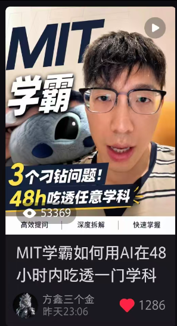

# 难得在小红书拿到一次结果

Day 184 · 2026-10-05

[全部文章](../../README.md#全部文章)

小红书是一个很奇特的平台，但是又是一个非常重要的平台，具体我认为有以下几个重要特质：

## 一、女性群体多，知识付费欲望强

## 二、学习、知识、个人成长类内容能获得较高的流量

## 三、封面大于一切

基于这三点，我认为这个平台无论如何都是要闯一下的，起码是有很强的变现空间，但是我一直都做不起来。

抖音、视频号、b站，这三个平台我做十几万的流量很轻松，感觉流量的分发是很正常的。

只有小红书这个平台，都是几十上百的阅读量，流量分发机制非常奇怪。

但是我也没有气馁，慢慢去做吧。

昨天拍的一个视频，总算拿到了小红书的一点点结果，到现在刚好24个小时，小红书5W播放量，抖音和视频号大概也有15W播放量吧，我总结下了原因：

**1**、题材符合个人成长和学习

**2**、AI话题有热度

**3**、封面设计还可以

继续加油！大家也继续加油！

持之以恒，日拱一卒。

---

上一篇：[No.183 纯粹的执行，无视情绪](day-183.md)

下一篇：[No.185 AI时代，没有什么比搞好身体更重要](day-185.md)

[返回目录](../../README.md#全部文章)
