# 孙哥四小时播客长谈拆解

> 强烈推荐大家去看最近邵艾伦和孙哥的长访谈《年轻人如何抓住AI时代的机会》，整整四个小时。

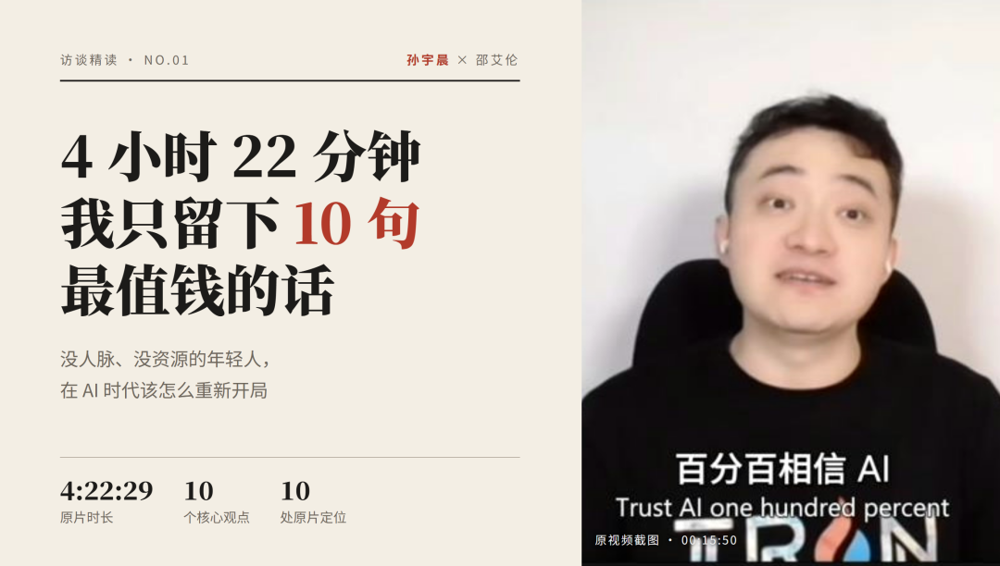
“强烈推荐大家去看下最近的邵艾伦和孙哥的长访谈《年轻人如何抓住AI时代的机会》，整整四个小时，我一点没加速的看完了，给大家总结一下。
这篇文章能帮你省下 4 小时。

先说结论：这场访谈到底在讲什么？
访谈第一个问题很直接：

如果你回到 20 岁，没人脉、没资源，怎么重新开始？
孙宇晨的回答第一句是："也还是不难。"
接下来四个多小时，他讲的可以压缩成一句话：
“先升级认知和工具，再去全球市场中提供价值，财富自然就来了。

乍一听其实像鸡汤，但是我觉得每一条其实都是很有道理的，只是和我们现实社会接触的大众三观不一样，所以会觉得很颠覆。
至少孙哥给的每一条都有可以今天就执行的动作，而且大部分零成本。
01｜生活 AI 化
原片定位：00:01:57

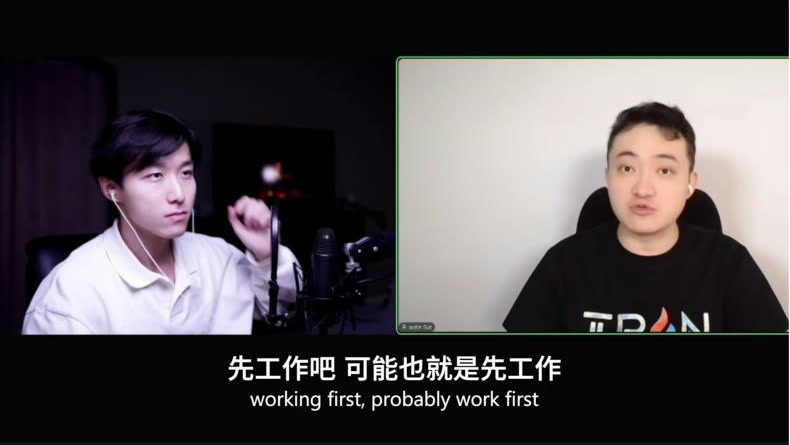
原片截图 00:02:01｜开场，孙宇晨讲自己现在的一天
孙宇晨描述了自己现在的一天：
吃饭前拍一张餐桌，吃完再拍一张，丢给 Claude 算热量、告诉他先吃哪道菜；

训练时让教练录视频，AI 记组数、重量，下次自动加一点（渐进超负荷）；

戴 Oura Ring 抓睡眠和消耗，和饮食数据相减，控制热量缺口在 600 卡以内；

每天 AI 自动出一份日报。

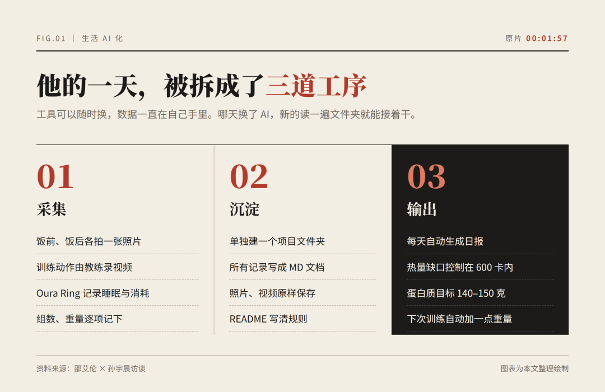
孙哥要求所有记录都存成本地的 MD 文档，照片也全部保存，再写一份 README。这样哪天换掉 Claude Code、改用 Codex，新的 AI 读完文件夹就能直接接手。
先谈下为什么这个行为一定是有效的。
心理学里有个概念叫「自我量化」（Quantified Self）：被测量的东西才会被改善。

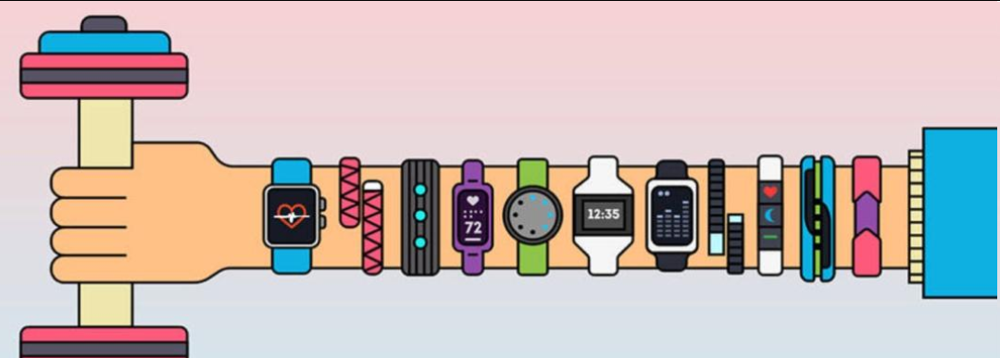

大多数人的问题不是不努力，而是对自己的状态一无所知，AI 化的第一步就是把模糊的自己变成清晰的数据。
做起来也很简单：
手机里建一个文件夹，名字就叫「我的数据」；

选一个最想改善的领域（饮食 / 睡眠 / 开支 / 学习），连续记录 14 天；

每天把记录丢给任何一个 AI，让它用 Markdown 格式输出当天总结。

02｜普通人零资源起步
原片定位：00:08:30

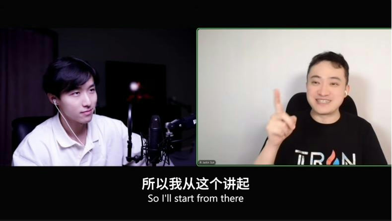
原片截图 00:09:02｜从「月可支配收入不到 1000 元」讲起
孙哥专门讲了「最底层」的情况：月可支配收入不到 1000 元。
建议其实还慢具体的：
Claude Code 一个月 200 美元，用不起就不用；

换成国产的同类编程工具（他提到了智谱、Kimi 等），很多有免费额度；

没电脑？手机也行，建个文件夹照样能做；

哪家有活动就用哪家，「今天吃东家，明天吃西家」。

关键其实就是要花时间，你要把你生活的方方面面全部喂给AI，花 2 到 4 个月积累自己的各类数据，让 AI去帮你分析方向。
穷人最贵的不是钱，是试错成本。
AI 把「请教一个懂行的人」的成本降到了接近零，在学习知识这条道路上，其实AI平权了信息差。
03｜与 AI 共决策
原片定位：00:15:46

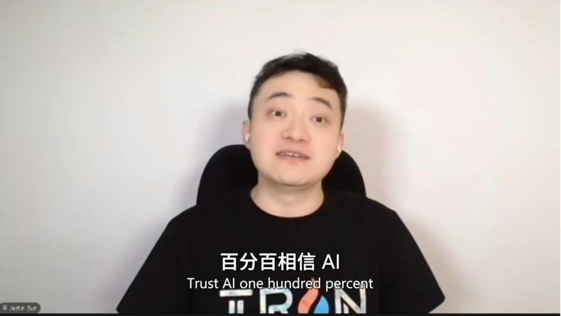
原片截图 00:15:50｜「百分百相信 AI」
这是整场访谈最「极端」的观点：百分之百相信 AI，让 AI 当掌舵者。
孙哥打了个比方：如果在开飞机，90% 的时间交给 AI，自己只花 10% 去调整。
我在生活中其实也是无脑相信AI的人（但是我不相信豆包），我对AI的信任程度大概是Claude > Codex > 其他大模型。
在路上开车也是的，任何路我都会开导航，不是我找不到路，而是我觉得加持了AI导航之后，有可能会有更捷径更不堵车的路走，而且我也相信人的大多数看法都是片面的，主观的，浅显的，只愿意相信自己所相信的。
所以如果一个AI，没有幻觉，说真话，是可以极大程度提高自己的认知的。
孙哥也讲了一个例子：他以前一直觉得蛋白粉是「科技」，跟用药差不多。和 AI 讨论之后才明白，蛋白粉和肌酸本质上就是食物，一个旧观念当场被翻过来了。
所以真正的方法是：

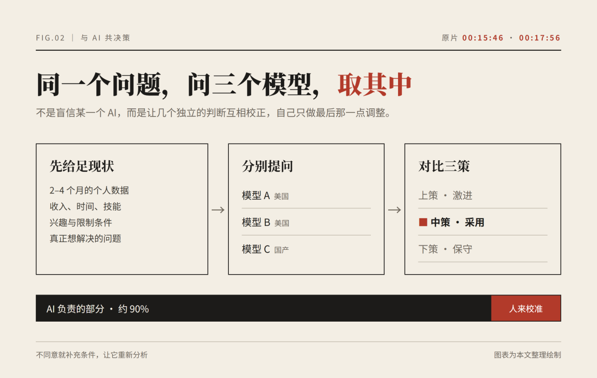
同一个问题，问三个顶尖模型（中美都要有），让它们各出上、中、下三策，取其中。
不同意就补充条件、让它重新分析。
这就是决策科学里的「群体智慧」：多个独立判断的平均值，往往比任何单个判断都更准。
你不是在盲信 AI，而是在用 AI 对冲你自己的偏见。
04｜年轻就是最大的本钱
原片定位：00:25:38

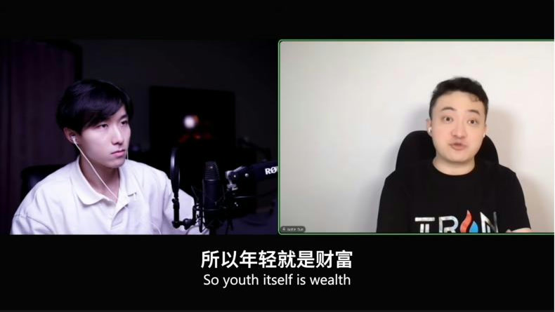
原片截图 00:25:40｜「所以年轻就是财富」
问：年轻人未来几年最值得 all in 的赛道是什么？
孙宇晨的回答出乎意料：AI 时代所有东西都会变便宜，唯一值钱的是寿命。
所以年轻本身就是财富。
举个数学的例子：过去中国学生 IMO 拿奖无数，顶级数学大奖却很少，一个重要原因是解题思路掌握在少数顶尖导师手里，你没进那个圈子就不知道路。现在 AI 把全世界的思路都学进去了，一个高中生借助 AI，可能直接拿到「博士级」的思路。
此外，天文学可能迎来本质性突破，因为望远镜传回了海量数据，过去枯燥到没人有时间处理。
年轻是最大的复利本金。
05｜赚全世界的钱
原片定位：00:32:40

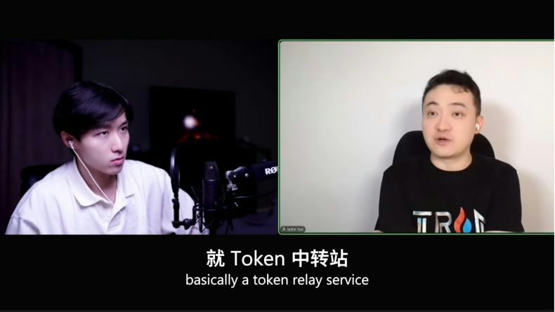
原片截图 00:33:54｜token 中转站的例子

播客里举了一个例子：同一个 AI 订阅服务，在不同国家价格差异很大，有的地区便宜，美国最贵。
这就是信息差，基于这个信息差是可以制造价值的。而且这个价值是全球性的，理论上你可以和地球任何上任何一个人做生意，也不是把眼界放在自己的国家去内卷。
这背后是一个更大的框架：
度量衡要变： 不能只考虑本市、本省、本国，要用全球视角；

核心问题只有一个： 你能不能把自己的价值体现在客户面前；

中国的优势： 世界工厂、产能充足，把东西、主意、想法卖到全世界都是机会。

4 亿中国年轻人不要在内部互相卷，而是去服务全球 80 亿人，以及未来越来越多的 AI。
我个人也认为，需求池足够大，这个行业不行，换一个就是。
经济学里最古老的赚钱逻辑就是套利：发现两个市场之间的差异，把价值从低处搬到高处。AI 让翻译、调研、客服的门槛几乎消失，个人第一次具备了做跨国生意的能力。
06｜看清楚再动手
原片定位：00:40:21

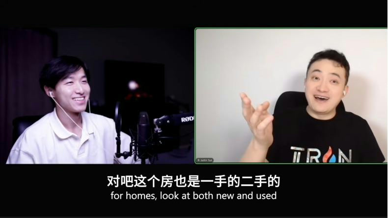
原片截图 00:40:34｜讲「先看 100 套房」
如果你看过孙哥2016年的播客，有个著名的「30 岁前不买房、不买车、不结婚」的理论。

但如果一定要买呢？
他的答案是：先看 100 套房，先看 100 辆车，别急着做决定。

看多了，别人怎么报价、什么值什么价，你自然就有了判断标准。
这个数字当然是有些夸张，但是这个理论概念我觉得可以学习一下，这里他引用了一个数学模型：

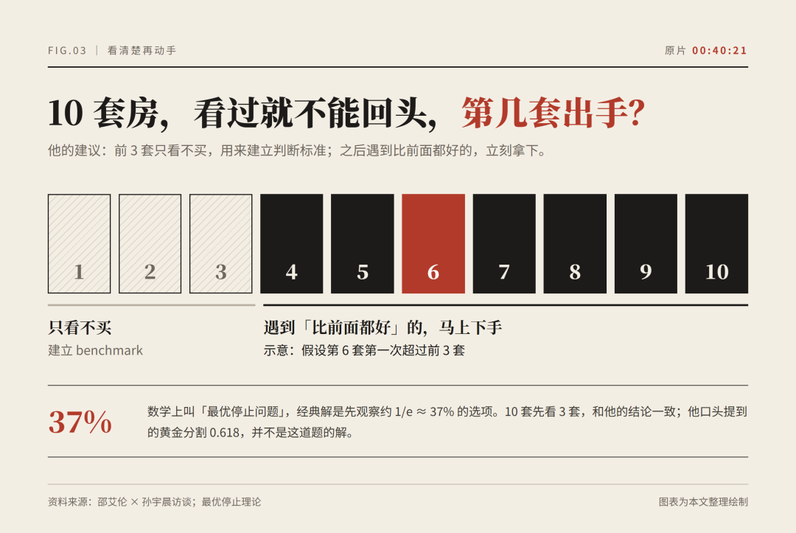
假设一共 10 套房，看过的不能回头买，那么前 3 套只看不买，用来建立基准；之后一旦遇到比前面都好的，立刻拿下。
“这就是数学上的「最优停止问题」，经典解是先观察约 37%的选项。
10 套房先看 3 套，正好吻合。

这套逻辑不只适用于买房。职业、城市、合伙人、赛道，样本量不够时做的决定，本质上都是在赌。
所以孙哥建议年轻人别太早给自己下定论，先多学、多听、多看，把 benchmark 攒够再说。
07｜逐水草而居
原片定位：01:22:47

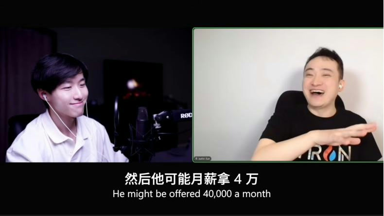
原片截图 01:28:07｜讲 OpenAI offer 的例子
孙宇晨说自己很欣赏游牧民族，可以用五个字概括：逐水草而居。
哪里有水有草，就去哪里。
他用了一个让人很难反驳的场景：
“明天早上 OpenAI 说录取你，来旧金山上班。你说「我在北京买了房，能不能在北京工作？」
大概率，这个机会就没了。

我其实也想成为一个游牧民族，想去世界的各个地方去看，去旅游，在途中我可以自由的工作，做自己想做的事情，拍自己想拍的视频，写自己想写的文章，这大概就是我觉得最好的工作状态吧。

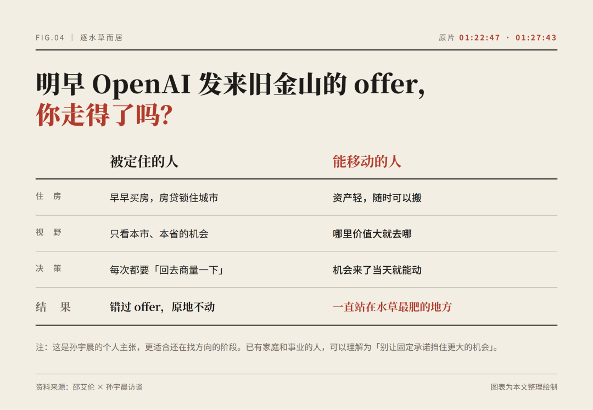
金融学里有个概念叫期权价值：保留选择权本身就有价格。一笔沉重的固定承诺，本质上是你提前卖掉了未来的选择权。
其实我觉得核心的理论是，不是让你不成家，而是在还在找方向的阶段，尽量不要让重资产、长周期的承诺挡住你走向更大的机会。
08｜让机器读得懂的东西才值钱
原片定位：01:38:00

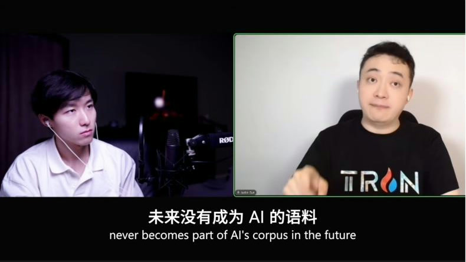
原片截图 01:40:04｜「未来没有成为 AI 的语料」
这是我个人认为整场访谈最深的一个观点。
他说人类正在从「碳基」向「硅基」过渡，数学、货币、所有发明都要翻译给机器，机器读懂了才能上路。他用自己的老本行举例：SWIFT 跨境汇款系统诞生于没有计算机和 AI 的年代，他所做的就是把这套东西翻译成机器能直接处理的形式。
我记得里面一句很有冲击力的话。
“一个东西如果没有成为 AI 的语料，它就等于从来没有发生过。

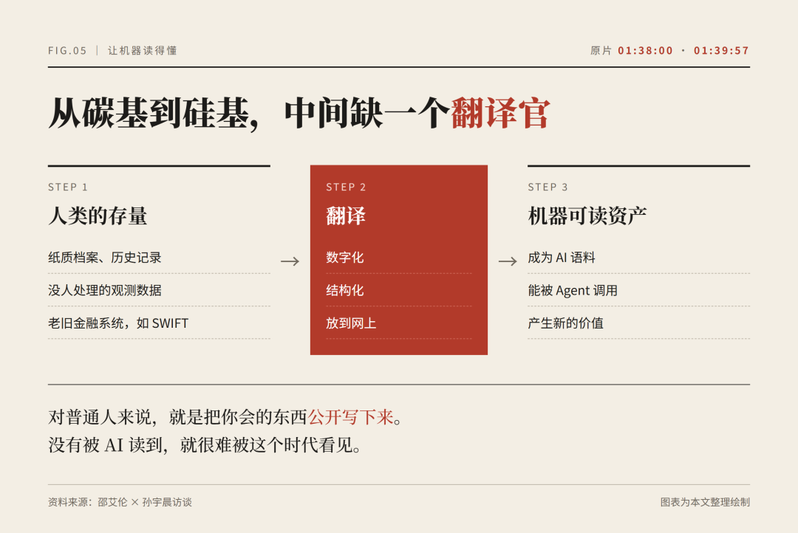
如果你的经验、作品、方法论，如果只存在于你的脑子里或者朋友圈里，在 AI 时代就是不可见的。
今天就能做： 把你最擅长的一件事写成一篇公开的、结构清楚的文章，发在能被搜索引擎抓取的地方。

这就是你在 AI 时代的「户口」。
这个概念太有冲击力了，我由衷的觉得。
09｜版本会更新，保持 small ego

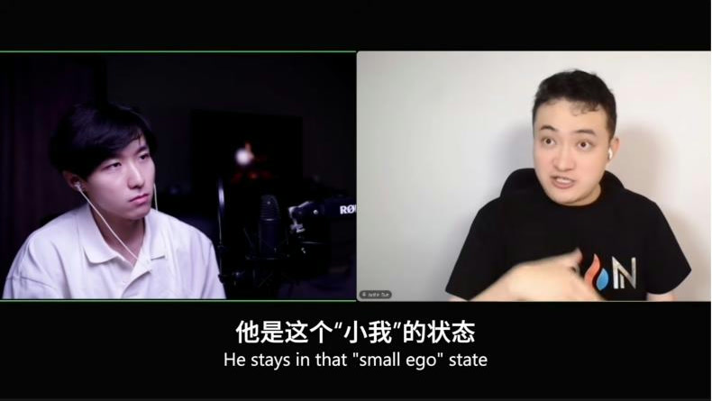
原片截图 02:10:48｜讲张一鸣的「small ego」
他用王者荣耀解释人生：游戏会更新版本，上个版本最强的英雄，下个版本可能直接被削弱。「地球 Online」也一样，没有一个打法能一招吃到黑。他举的例子是某个大版本更新里房地产被「砍了一半」，今天押对了 AI，也不代表明天还能躺赢。

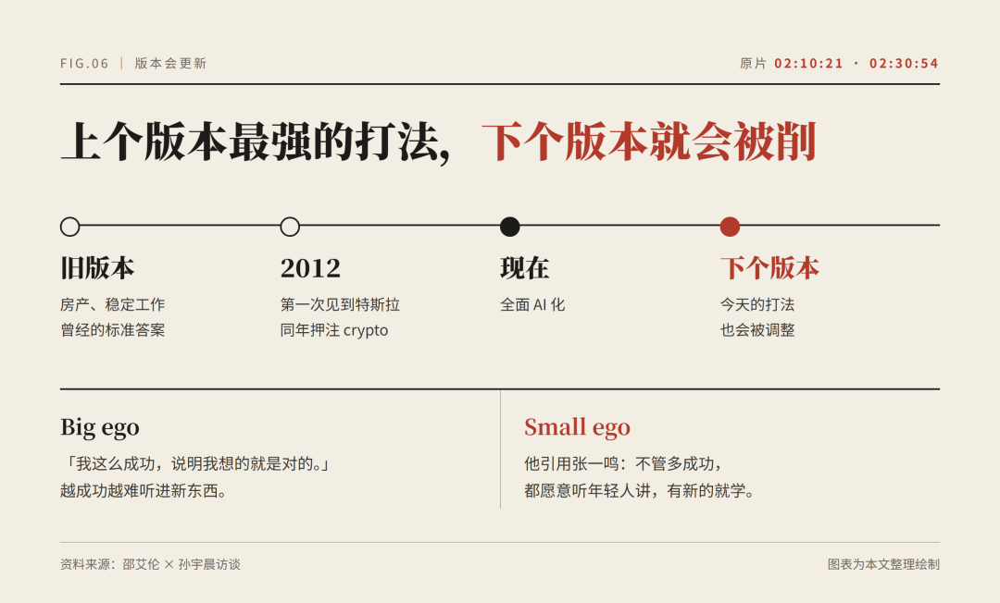
怎么跟上版本？
① 早更新，早超生。
系统硬扛着不更新，越来越多东西就不再支持你。他说 2012 年第一次见到特斯拉时就认定这是革命，同一年押注了 crypto。在他看来，赚钱多只是副产品，根本原因是这件事在社会中扮演的角色越来越重要。
② Small ego。
字节跳动能一直赢，是因为不管多成功，都愿意听年轻人讲、愿意学新东西。他说了一个很反直觉的「诅咒」：越成功的人 ego 越大，因为成功似乎证明了「我是对的」，而这恰恰会让他错过下一个版本。
过去的成功会让人过度相信旧模型。
保持 small ego，本质上是持续给自己的大脑打补丁。
10｜先自由后财富，多创造少消费
原片定位：02:43:27

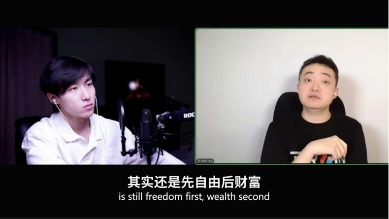
原片截图 02:43:37｜「其实还是先自由后财富」
这是他说「比 2016 年讲得更深刻」的升级版：
“财富自由，其实是先自由，后财富。财富是自由的伴生品。

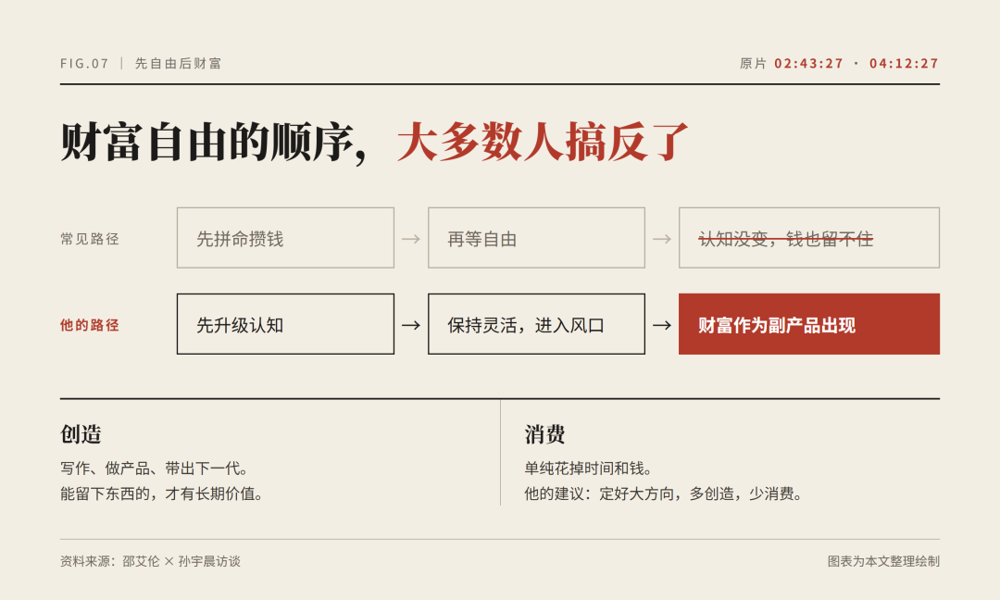
很多人以为「有钱了才能自由」，恰恰相反：只有认知自由、行动自由，你才能灵活地进入风口，拿到与风口相匹配的财富。
人的活动分两种：创造和消费。
单纯的消费没有意义，定好一个大方向，多做创造性的事。
「缺啥补啥」，上班的人不想上班，而他这个没上过班的人特别想上班，最想进 OpenAI 和 Anthropic，因为好公司能给他提供 benchmark。

怎么看待这场访谈？
公平地说，这场访谈里有不少孙宇晨式的极端表达：百分之百相信 AI、30 岁前不买房不结婚、「孙学」「搏击」「黄毛」三大理论……
但如果剥掉表达方式，内核其实很朴素：
用最便宜的工具，把自己变成数据；

用多个 AI 对冲自己的偏见；

保持机动，去全球找价值最大的地方；

持续更新版本，别被过去的成功困住。

这四件事，哪一件都不需要你有钱，也不需要你有人脉。
