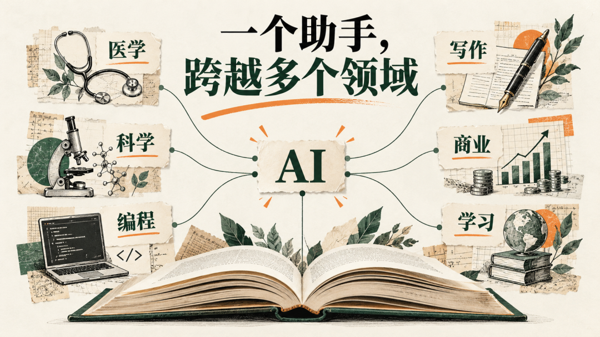

# AI一切化，一切AI化

Day 188 · 2026-10-12

[全部文章](../../README.md#全部文章)

“为什么 AI一切化，一切AI化是对的？

孙宇晨说他现在「全部 AI 化」：吃饭拍照交给 AI 算热量，训练录视频交给 AI 记录，每天让 AI 给他出日报。

很多人听完第一反应是：「这不就是有钱人闲得慌、折腾工具吗？跟我一个普通人有什么关系？能帮我提升自己吗」

我们从两方面来讲：一是理论，二是实操。

毕竟我们还是要讲究一个知行合一。

一切 AI 化、一切AI化的本质目的——是为了提高你生活的科学性、合理性，让你生活的更健康，更快乐，更合理。

大家有时候真的低谷了AI的强大性，AI 就像一个超级博士一样。

还不是那种单一领域的博士，而是汇聚了人类有史以来在互联网上所有知识的超级博士。

换句话说，你去请个大学生，一个小时都还得几百块呢。而一个超级博士，随时随地回复你，你想怎么问就怎么问，一个月只要两百块，这简直在以前不敢想象。

我记得我以前初高中的时候喜欢看钢铁侠，也希望拥有一个自己的贾维斯。

现在其实已经是贾维斯的雏形了，甚至在一定程度上都超越了贾维斯。而大家不愿意去用，我是觉得很不理解的。我只能认为你是不愿意给自己一个提升，或者说进步的机会。

## 普通人用 AI 有什么用？

我觉得不要去划分普通人和精英人群用 AI，因为目前为止，区别是不大的。

现在还是 AI 快速发展、市场蛋糕初步定型的阶段，普通人用的 AI 和有钱人用的 AI，本质上几乎是没有区别的。

孙哥用的是 Claude，你不一样可以用 Claude 吗？哪怕你用不上 Claude，你去用 Codex；Codex 你用不上的话，你就去用 DeepSeek、豆包。

我觉得本质上也不会差很多——因为把自己 AI 化这个工作，对于 AI 来说是一个很简单的任务，根本就不需要很强大的 AI，只需要你有很强烈的信念和使用欲望。

有时候我都觉得「AI」这个词太模糊了，因为它太广泛了，不细化就无法突出它的重要性。

如果单论身体健康、薄肌而言，我觉得把 AI 叫做「天才医生」，会让大家更容易接受一点。

你想象一下，有一个私人健康医生，随时随地监控你的情况，随时随地分析你的情况，随时随地回答你的问题。在 AI 没有出来之前，这是一件天方夜谭的事情。

AI 的出现之猛烈，甚至让大家忘记了这件事有多么神奇。

如果我们把自己的生活一切 AI 化：我们每天的热量可以得到实时的监控，我们身体每天的运动状态可以实时监控，我们的皮肤状态、睡眠状态、合理消费，我们的 everything，都可以利用人类最前沿、最顶级的精华智慧。这是一件多么幸福的事情啊。

你可以最大程度地去提高你自己的能力，去拓宽你的职业边界，去提高你的认知水平，就像海绵一样，不断汲取人类海洋中的智慧。我光是想到这些，就觉得很兴奋。

好，说完理论，我们来讲实战。我会讲得很细，都是我自己实际操作过的。我尝试过三种路径：

一是 Hermes；

二是飞书豆包 + 多维表格；

三是建立个人 MD 文档，用 Obsidian 之类的工具。

我今天着重讲前两个，我都会详细讲怎么操作，以及需要用到的提示词和 skill。最后一个Markdown+Obsidian后面序会单独出一个长篇视频来讲。

## 【实战部分】

第一种，快捷方便，不过可能要花 68 块钱；

第二种，个性化一点，价格也低一点。

大家根据个人情况自己选择。

### 方法一：豆包 + 飞书多维表格

如果你想以最快的方式去连接你的生活，我最推荐给你的是豆包。

为什么是豆包呢？

**1**、方便，首先是你手机上直接可以使用，

**2**、准确，豆包可以和飞书的多维表格直接互动，这是最最关键的。

如果你直接在对话框里和 AI 聊天，讲述你的个人情况，聊了一两个月之后，你会发现 AI 把你之前跟它说的东西忘了。

而豆包 + 多维表格完美地解决了这个问题。

唯一的代价是你可能要花68块钱每月开会员。

当你把你的情况发给豆包，豆包会把你的个人档案自动做成多维表格进行存储。这是一种实质性的记录：不管你记录了几个月还是几年，数据都是实打实的，永远不会出现 AI 幻觉。

在这里我给大家一个提示词。

#### 提示词 ①：建档 + 每日记录（【Claude 起草】）

“可以直接复制给豆包。中括号里的内容换成你自己的。

> 你现在是我的私人健康管家。请帮我在飞书多维表格里建立并长期维护我的个人健康档案。
>
> 【我的基本情况】
>
> - 性别：[ ]，年龄：[ ]，身高：[ ] cm，体重：[ ] kg，体脂率（如知道）：[ ]%
>
> - 目标：[例如：3 个月减脂 5 公斤 / 增肌 / 改善睡眠]
>
> - 作息：一般 [ ] 点起床，[ ] 点睡觉
>
> - 运动基础：[例如：零基础 / 每周跑步 2 次]
>
> - 饮食习惯和忌口：[ ]
>
> - 正在吃的补剂：[例如：蛋白粉、肌酸、维生素 D]
>
> 【请建立以下数据表】
>
> **1**. 「个人档案」表：记录上面的基本情况，每次体重、体脂变化都新增一行，保留历史。
>
> **2**. 「每日记录」表，字段包括：日期、早/午/晚餐与加餐内容、估算热量、估算蛋白质（克）、饮水量、补剂打卡、运动项目与时长、睡眠时长、入睡时间、今日状态（1–5 分）、备注。
>
> **3**. 「每周复盘」表：每周日汇总本周平均热量、蛋白质、睡眠、运动次数、体重变化。
>
> 【之后的工作方式】
>
> - 我每天会用文字或照片告诉你吃了什么、做了什么。你负责识别、估算并填进「每日记录」表，不需要我手动填。
>
> - 每次记录后，用 3 句话以内告诉我：今天还差多少蛋白质、热量是否超标、明天一个最该改进的点。
>
> - 每周日主动帮我生成「每周复盘」，指出最大的问题和下周的一个小目标。
>
> - 热量和营养都是估算，请标注「估算」，不要假装精确。
>
> - 回答我之前，先查阅表格里的历史数据，不要凭记忆回答。
>
> - 如果我的描述不清楚，先追问一句再记录。
>
> 现在请先根据我的基本情况，把表格建好，然后告诉我第一天该怎么开始记录。

（你的口述）

你还可以给自己设计一个游戏升级模式，用积分来激励自己。比如我喜欢读《凡人修仙传》，我就给自己设置了一套升级、记录的机制。我的饮食、睡眠、吃维生素、运动，都会按照修仙的境界来升级、记录、激励。

#### 提示词 ②：修仙升级系统（【Claude 起草】）

“用的是修仙小说通用的境界设定，喜欢别的题材（比如武侠、游戏段位）可以让豆包照着改。

> 请在我已有的健康档案基础上，加一套「修仙升级系统」，让我把每天的健康习惯当成修炼。
>
> 【世界观】
>
> 我是一名刚踏入仙途的散修，每天的饮食、睡眠、运动、补剂就是我的修炼功课。修为（经验值）积累够了就能突破境界。
>
> 【每日修炼与修为奖励】
>
> - 早睡（[23:30] 前入睡）：+10 修为｜睡足 [7] 小时：+10
>
> - 蛋白质达标（[ ] 克）：+15｜热量控制在目标范围：+10
>
> - 完成力量训练：+20｜有氧或步数达标（[8000] 步）：+10
>
> - 按时吃补剂（维生素等）：+5｜喝水达标：+5
>
> - 当日全部完成：额外奖励「灵石」×1
>
> - 熬夜、暴饮暴食：-10 修为，记为「心魔入侵」，但不清零，第二天可以补救
>
> 【境界体系】（每个大境界分初期、中期、后期）
>
> - 练气期：0–300 修为（养成记录习惯）
>
> - 筑基期：300–1000（作息和饮食稳定）
>
> - 结丹期：1000–2500（体态开始明显变化）
>
> - 元婴期：2500–5000（习惯完全内化）
>
> - 化神期：5000 以上（可以带别人一起修炼）
>
> 突破大境界时，请给我写一段 100 字左右、有仪式感的「突破描述」，并总结这一阶段我真实的身体数据变化。
>
> 【法宝与奖励】
>
> - 灵石可以兑换我自己设定的奖励：[例如：5 灵石＝一顿喜欢的饭；20 灵石＝买一件新运动装备]
>
> - 连续 7 天全勤，获得一件「法宝」称号（比如「不眠之剑」「铁胃葫芦」），记录在档案里。
>
> 【表格要求】
>
> 在多维表格里新增「修炼日志」表：日期、当日修为、累计修为、当前境界、灵石余额、心魔记录、当日一句话点评。
>
> 每天我汇报完，用修仙小说的口吻回复我（不超过 5 句），告诉我今日修为、离下次突破还差多少，以及明天的修炼重点。
>
> 数据必须如实记录，奖励规则不能因为我求情而放水。

### 方法二：Hermes

第二种方法是 Hermes。

如果说豆包 + 多维表格是「请了一个记账的管家」，那 Hermes 更像是「养了一个会成长的私人助理」。

它是什么？ Hermes 是 Nous Research 做的一个开源 AI 智能体，软件本身免费。它和普通聊天 AI 最大的区别有三点：

第一，它有长期记忆。你告诉过它的事情，它会一直记着，不会聊几个月就忘了。

第二，它会自己学技能。同一件事你让它做几次，它会自己总结出一套固定做法，下次做得更快、更好。用得越久，它越懂你。

第三，它会主动找你。你可以跟它说「每天晚上 10 点给我发一份今日总结」，到点它就自己发过来，不用你开口。

为什么说它更个性化、更便宜？ 因为模型是你自己选的。软件不要钱，你只需要接一个大模型。可以接国外的，也可以接国内便宜的模型 API，按用量付费，一个月的成本通常比会员还低。

#### 怎么开始？

我给大家一个提示词，大家直接发给任何的Agent就行了，其中包含安装、接入大模型（如Deepseek等）、个人建档、设置定时任务和接到手机上（你可以接入飞书等）。

> 你是一名耐心的技术助理。请带我在这台电脑上从零搭建 Hermes Agent（Nous Research 出品的开源 AI 智能体，官网：https://hermes-agent.nousresearch.com/），把它变成我的私人健康助理。我不懂编程，请每一步都用大白话告诉我在做什么，执行任何安装命令前先跟我确认。
>
> 【第 1 步：检查环境并安装】
>
> - 先判断我的电脑系统（Windows / macOS / Linux）。
>
> - 以官网和官方文档为准进行安装。官网目前给出的安装方式：
>
> · Windows（PowerShell）：irm https://hermes-agent.nousresearch.com/install.ps1 | iex
>
> · macOS / Linux（终端）：curl -fsSL https://hermes-agent.nousresearch.com/install.sh | bash
>
> · 也可以从官网下载桌面版安装包
>
> - 执行前先打开官网核对命令是否有更新；不要运行任何非官方来源的脚本。
>
> - 安装完成后验证是否能正常启动。
>
> 【第 2 步：接入大模型】
>
> - 默认帮我接入 DeepSeek（性价比高，国内可用）。DeepSeek 的接口兼容 OpenAI 格式，具体接口地址和模型名称以 DeepSeek 官方文档为准。
>
> - 告诉我去哪里注册、怎么生成 API Key。API Key 由我自己粘贴进配置文件或环境变量，你不要让我把 Key 发在对话里，也不要把它显示或打印出来。
>
> - 配好后发一条测试消息，确认模型能正常回复。
>
> - 如果我想换成其他模型（比如 Claude、GPT、通义、Kimi），告诉我改哪里。
>
> 【第 3 步：个人建档】
>
> - 一次问我一个问题，帮我建立健康档案：性别、年龄、身高、体重、体脂率（如知道）、目标、作息、运动基础、饮食习惯与忌口、正在吃的补剂、身体旧伤或特殊情况。
>
> - 把档案写进 Hermes 的长期记忆，同时在本地存一份 Markdown 备份（例如「我的健康档案.md」），并告诉我文件位置。
>
> - 之后每天的饮食、运动、睡眠记录，也按日期追加到本地 Markdown 文件里，保证数据永远在我自己手里。
>
> 【第 4 步：设置定时任务】
>
> - 每天 22:00：提醒我汇报今天的饮食、运动、睡眠和补剂，然后生成一份日报（热量与蛋白质是否达标、睡眠情况、明天最该改进的一件事），热量和营养数据要标注「估算」。
>
> - 每周日 21:00：生成周复盘（本周平均数据、体重变化、最大问题、下周一个小目标）。
>
> - 可选：每天 07:30 发一条早安提醒，结合昨晚睡眠给出今天的训练建议。
>
> - 提醒我：电脑关机或 Hermes 没在运行时，定时任务不会执行；如果需要 24 小时在线，告诉我放到云服务器上的方案和大概费用。
>
> 【第 5 步：接到手机上】
>
> - 优先接入飞书，让我在手机上就能跟它聊天、收日报。
>
> - 先查官方文档确认 Hermes 当前支持哪些消息渠道：
>
> · 如果原生支持飞书，按官方方式配置；
>
> · 如果不支持，用飞书开放平台的机器人来实现推送和对话，并一步步告诉我需要在飞书后台点哪里；
>
> · 如果飞书走不通，再退回到官方支持的渠道（如邮件、Telegram、Discord）。
>
> - 需要登录或授权的网页操作由我自己完成，你只告诉我怎么做。
>
> - 配好后，让 Hermes 往我手机上发一条测试消息。
>
> 【第 6 步：验收与交付】
>
> - 完整跑一遍：我汇报一条饮食记录，它能记住、写入本地文件，并给出反馈。
>
> - 最后给我一份清单：装在哪里、用的什么模型、档案和记录存在哪个文件夹、定时任务有哪些、手机怎么联系它、以后怎么备份和迁移。
>
> 遇到报错先自己排查，解决不了再用大白话告诉我原因和下一步怎么做。

修仙升级系统在 Hermes 上也一样能用，把提示词 ② 发给它就行。而且因为它会自己学技能，用一段时间之后，它会越来越懂你的修炼节奏。

提醒两点：

一是，Hermes 是装在你自己电脑上跑的，电脑关机，定时任务就不会执行。想让它 24 小时在线，可以以后再考虑放到云服务器上。

二是，你的记忆和技能都存在本地，换电脑之前记得备份它的数据文件夹。

## 两种方法怎么选？

想今天就开始、不想折腾：选豆包 + 飞书多维表格。

想要一个越用越懂你、会主动找你的助理，愿意花一个下午研究：选 Hermes。

不管选哪一种，最重要的不是工具，而是坚持不懈。

一切AI化，AI一切化。

---

上一篇：[No.187 孙哥四小时播客长谈拆解](day-187.md)

下一篇：[No.189 人们对大模型（LLM）能力的认知差距正在急剧拉大](day-189.md)

[返回目录](../../README.md#全部文章)
