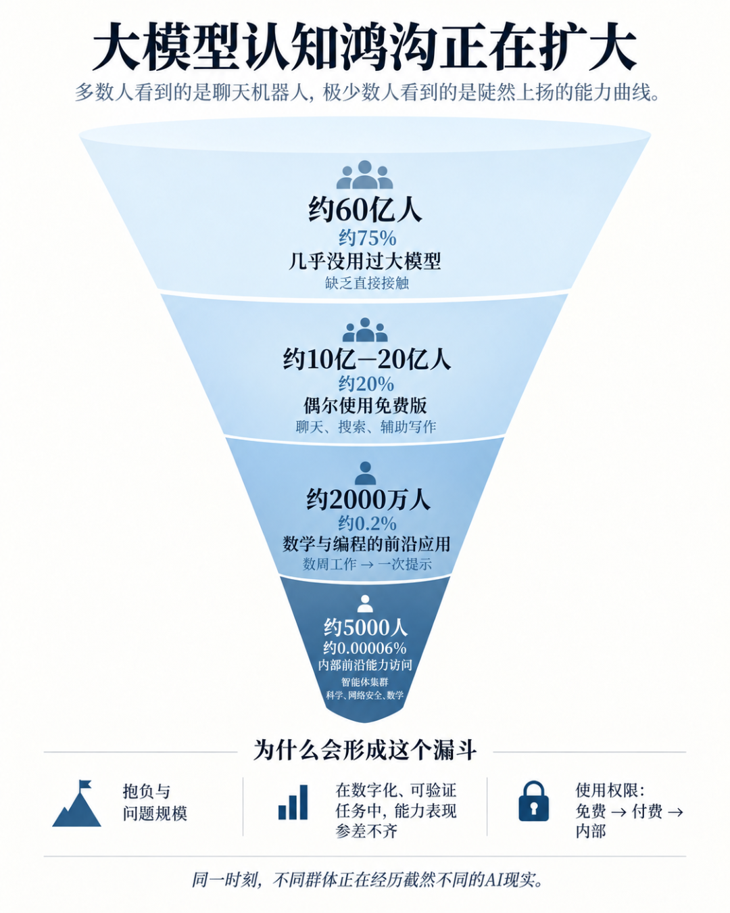

# 人们对大模型（LLM）能力的认知差距正在急剧拉大

> Andrej Karpathy 最近发布了一篇文章，核心观点是：人们对大模型（LLM）能力的认知差距正在急剧拉大。

Andrej Karpathy 最近发布了一篇文章，
核心观点是：人们对大模型（LLM）能力的认知差距正在急剧拉大，已经从“两拨人各说各话”变成了一个非常陡峭的“漏斗”。
现在大家对 AI 能力的理解出现明显分歧，主要原因有两个：
1. 使用版本和时效问题
很多人还停留在去年免费版 ChatGPT 的印象（幻觉多、各种翻车视频），这些老模型完全不能代表今年的前沿智能体模型（如 OpenAI Codex、Claude Code）。
2. 能力分布差异大
即使付费使用最强模型，日常搜索、写作、建议类任务的提升也没那么夸张。
真正发生质变的是编程、数学、研究这类可验证奖励（verifiable rewards）的技术领域，因为这些领域既适合强化学习训练，又最赚钱，所以公司把最大力气花在这里。
结果就是：一部分人觉得 AI 还是“傻傻的聊天机器人”，另一部分在技术岗位上用最强模型的人则觉得能力进步“令人眩晕”，两边完全对不上话。
而在现在的十月，不只是认知上的差距了这个认知差距正在进一步扩大，形成了一个非常陡的漏斗结构，大致分成四层。

①约 60 亿人（全球人口的 ~75%）
几乎没怎么接触过 LLM。
②约 10-20 亿人（~20%）
偶尔用免费版 ChatGPT 类产品的普通用户。
他们看到的是“有点笨的聊天机器人”，当成更好的搜索引擎、写作辅助工具，或者偶尔让智能体帮忙订机票。
很多非技术背景的专业人士（包括不少高管）也属于这一层——他们知道 AI 在发生什么，但主要是二手信息，感觉比较抽象。
③约 2000 万人（0.2%）
在数学、编程等领域专业使用前沿级模型的人。
他们亲眼看到：以前需要几周甚至几个月的大项目，现在用一句话提示就能让智能体完成。
包括开发应用、复制应用、翻译应用、从二进制反编译应用等。
④约 5000 人（0.00006%）
能接触到公司内部最前沿系统的人。
外部世界已经看到了预告：成千上万个智能体协作数周，做软件超级项目、批量挖掘 0-day 漏洞、以机器速度进行网络攻防、发现新科学、推进数学前沿……
这些以前顶级专业人士需要多年才能完成的事，现在正在发生。
人类的审核和理解速度已经开始跟不上（他举例说，OpenAI-HF 事件几个月后还有人在做“考古”；数学家可能还要慢慢消化那 722 篇前沿数学手稿）。
现在处于非常两极分化的阶段。
公众大多没真正用过这些系统；用过的人看到的多半是“笨机器人”。
大多数专业人士也只感受到有限提升。而极小一撮专业人士正在经历“曲线突然垂直向上”的眩晕。
这些事情在同一时间同时发生。
神奇的世界。
我常常说，每次使用 AI 的时候我会感受到恐惧，仿佛我在凝视深渊，深渊也在凝视我。
