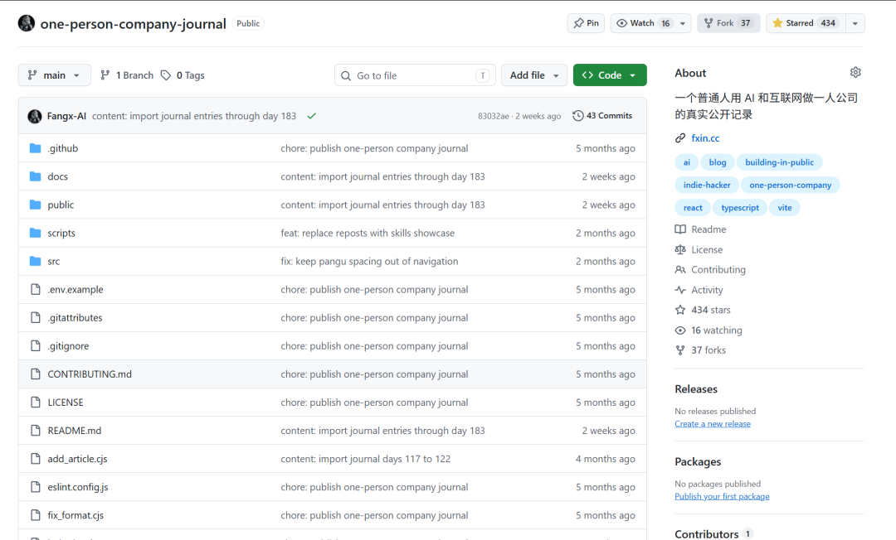

# 一人公司纪实突破 400 Star！

Day 192 · 2026-10-16

[全部文章](../../README.md#全部文章)

今天，我的「一人公司纪实」GitHub 项目突破 400 Star 了，目前是 434。

很开心！

这个项目主要就是文字记录。做了什么产品，拍了什么视频，试了什么工具，卡在哪里，下一步准备干什么，都往里面放。

从最早做桌面待办清单，到后来拍口播、做网站、研究 AI 工具，翻一下目录，就能看到这一路都在折腾什么。

里面有产品上线，也有软件被封、方向调整，还有没做完的事。

我有主业，副业也不只有开发。写文章、拍视频、学习和整理，这些都占时间，也都算我做过的事情，所以一起记下来。

看某一篇，可能只是几件很零碎的小事。

放在一起，就能看出一个项目怎么开始、怎么修改，一个想法后来有没有继续做。

感谢大家愿意收藏，也欢迎来翻翻，挑自己感兴趣的看。

项目地址：一人公司纪实

---

上一篇：[No.191 Geo-doctor](day-191.md)

下一篇：[No.193 本周汇总任务](day-193.md)

[返回目录](../../README.md#全部文章)
