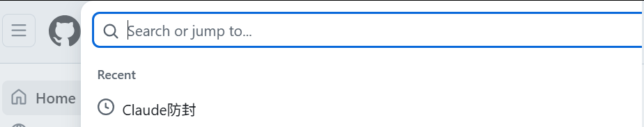
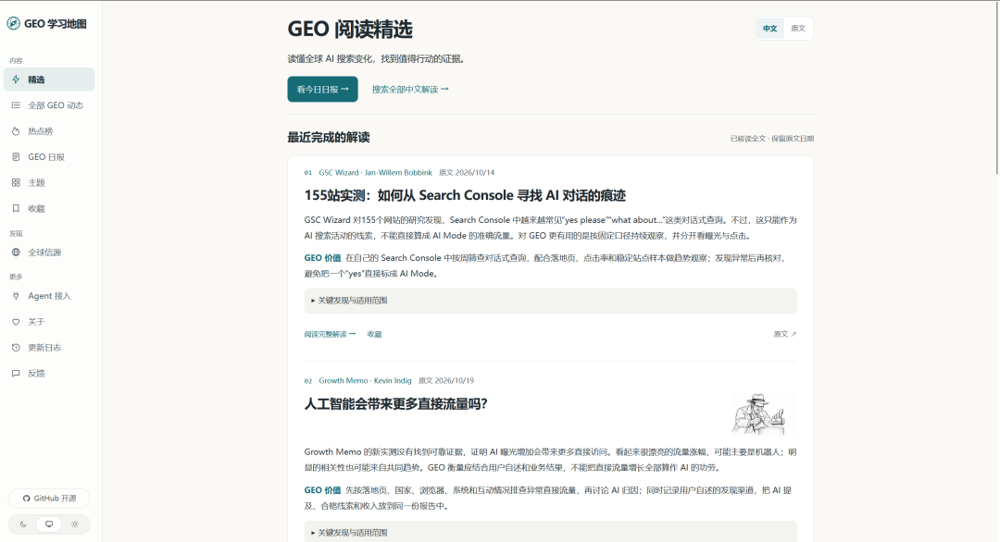

# 本周汇总任务

> 这几天要给腿做个手术，难得的清静时间可以在医院住一个星期，静下心来去研究下AI、GEO和自媒体。

这几天要给腿做个手术，难得的清静时间可以在医院住一个星期，静下心来去研究下AI、GEO和自媒体。

初步规划下这个星期的工作、后面也可能会调整

1、Claude防封教程

本来昨天想发布梳理总结一下自己的Claude防封文案，直接平台警告了，不能直接发布这类内容，无奈。

当然其实方法有千千万，也不复杂，大家只需要在Github或者X上搜索一下Claude防封就行。

里面有非常多前人的经验和教程，只要想办法总能解决的。

我还是推荐大家尽早用上Opus5.5，就目前使用体感来说，全球独一档。

2、开源GEO学习地图

这是一个我自己开发的项目，Codex差不多跑了20亿左右的token吧，但是我自己其实还是很不满意，所以我准备让Opus再去优化一下，然后发布到Github项目。

方便自己学习GEO的同时，也可以让大家更了解GEO，学习GEO，一起相互交流。

3、将Image2网站用Opus跑一遍流程。

最近越来越不信任Codex了，我准备让Claude自己去扫描整个服务器，看看项目有没有可以优化和修复的地方

4、深入探索GEO领域

①观察市面上已经有的开源GEO项目，尤其是GEOflow。

②同时把姚老师以前的文章都看一下，深度学习一下GEO的内容。

③了解下GEO的同行们都是怎么做的，多问多学

④把社媒的一些资料换成GEO相关的（抖音、小红书、视频号，b站）

⑤准备做一些系列性的GEO视频（提前先准备好稿子）

⑥组建GEO社群，多方面打造，积累资源。

5、准备好稿子的素材，等出院后开始拍摄。
