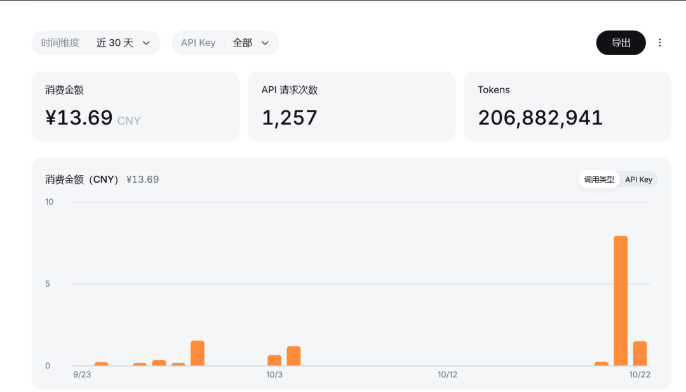
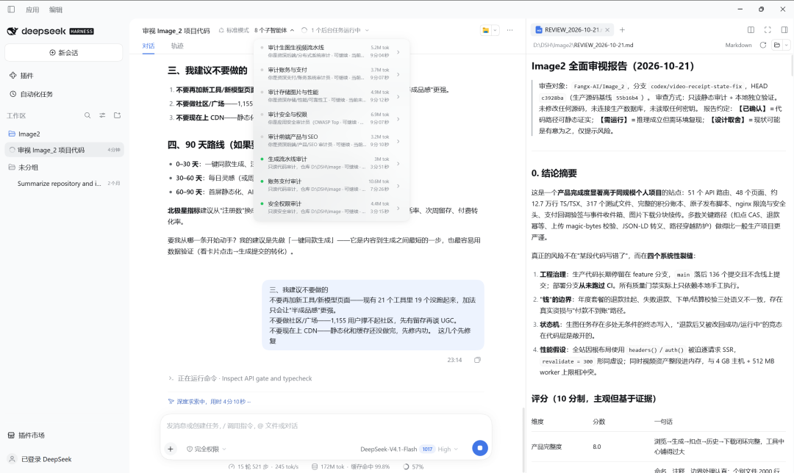
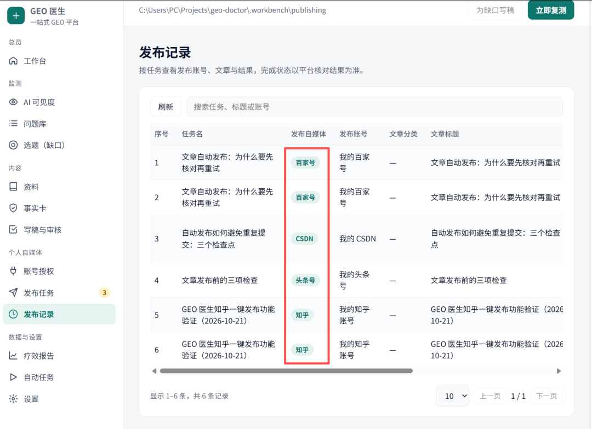

# Deepseek再使用

Day 194 · 2026-10-22 · [公众号原文](https://mp.weixin.qq.com/s/J-okFd9gAuicTj8_z7greQ)

[全部文章](../../README.md#全部文章)

前两天经群友推荐，说Deepseek很猛，重新下回来了。

这两天跑了差不多2亿的Token吧，花了13块钱，价格还真是不贵。

然后比较惊喜的是DeepSeek现在给我的干活体验远胜于Codex。

我让Codex重新审视我的Image2网站进行迭代重构。

每个智能体在干什么一清二楚。

强烈推荐大家去使用一下Deepseek-v4 + DSH，还可以安装很多的社区插件，简直不要太棒。

我说实话，我第一次对国产的大模型感觉到了兴奋！！

此外，这两天的GEO也有了很大的进展，现在目前我们的GEO项目可以做到一键分发平台了（简书，CSDN，知乎，b站等等……）

加油！！

---

上一篇：[No.193 本周汇总任务](day-193.md)

下一篇：[No.195 GEO确定是有效果的](day-195.md)

[返回目录](../../README.md#全部文章)
