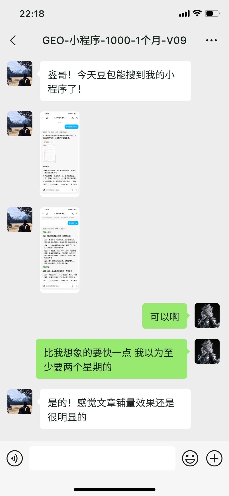

# GEO确定是有效果的

> 在做GEO之前，我会想怎么验证GEO是有效果的。

在做GEO之前，我会想怎么验证GEO是有效果的。

做了之后我发现这个问题太简单了。

对于绝大数的中小企业而言，互联网上根本就搜不到他们的企业。

就算能搜到他们的企业，也搜不到他们的产品。

就算能搜到他们的产品，也搜不到他们产品的具体信息。

就算能搜到他们产品的具体信息，也不知道他们产品的具体价格是多少，零售价是多少，批发价是多少等等。

所以对于大多数企业来说，根本就不是1-100的问题，而是从0-1的问题。

既然是从0-1的问题，那么有没有效果，你搜不搜的到就已经可以证明了。

昨天你搜不到，我们昨天GEO服务后，你搜到了，这就证明我们的服务是有效果的。

参考今天的小程序推广，这个我们收的是1000块一个月。

之前豆包是搜不到他的小程序的，现在能搜到了，也就证明我们的价值了。

目前我们可以分发这些平台，除此之外，还可以定制化一些平台。
