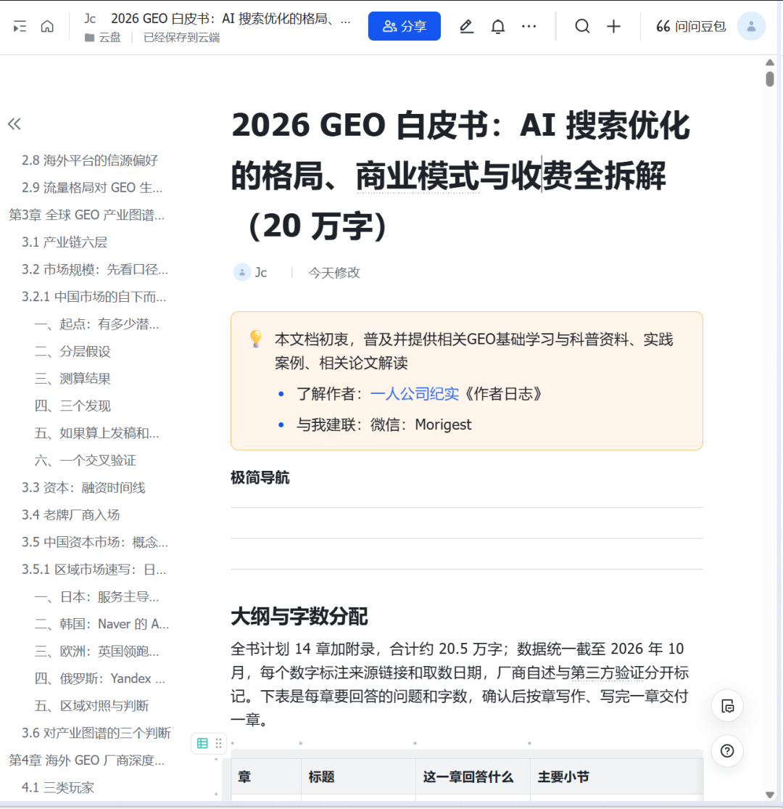
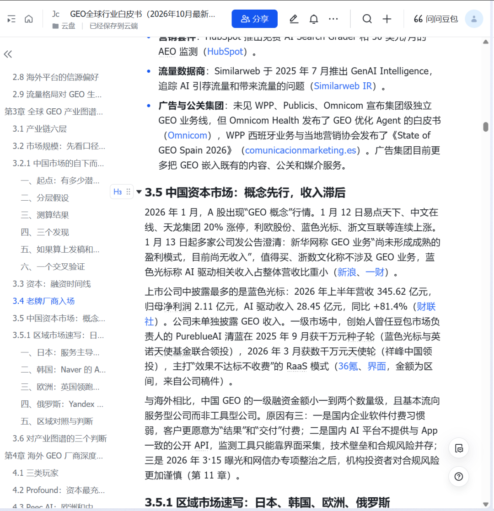
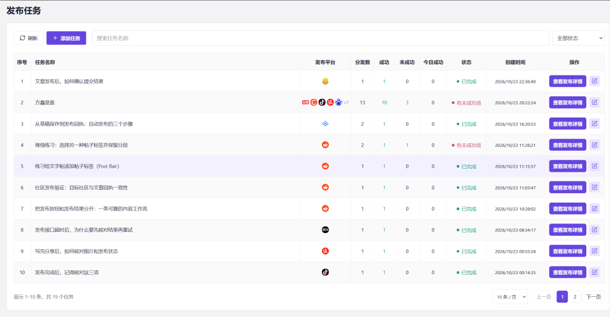

# 2026 GEO 白皮书：AI 搜索优化的格局、商业模式与收费全拆解（20 万字）

> 最近手头在准备三件事：

最近手头在准备三件事：

打磨 GEO 白皮书

继续优化 GEO 分发项目

准备 GEO 系列课程

一、打磨 GEO 白皮书

最近手头在准备的第一件事，是继续打磨 GEO全球行业白皮书

先交代一下背景。

这本白皮书的全名是：

2026 GEO 白皮书：AI 搜索优化的格局、商业模式与收费全拆解（20 万字）

它覆盖的是“全球 + 最新”：

海外 AI 搜索入口：ChatGPT 周活约 12 亿、Google AI Overviews 月活超过 25 亿

中国独立市场：豆包月活达到 4.19 亿

产业链与市场规模

海外厂商拆解

中国服务商格局

九种商业模式

定价与毛利

交付 SOP

效果衡量方法

合规红线

2027—2028 年趋势判断

整本白皮书包含 13 章正文，以及术语表、大事记、来源索引、价格总表、RFP 模板等附录。

为什么要做这本白皮书？

因为 GEO 在 2026 年已经是一门真实的生意，但行业里的信息太碎、口径太乱。

同一个市场规模，不同券商给出的数字能相差三十倍。

“AI 排名”这种说法满天飞，但实际上，同一个问题连续询问两次，出现相同品牌列表的概率可能不到 1%。

服务商层面，3·15 曝光投毒、清朗专项处置 1.4 万余款 AI 产品、多渠道分发规定落地，合规已经变成一条生死线。

这个行业缺的不是观点，而是一份能够把口径讲清楚、把数字标出来源的底稿。

“打磨”主要在做什么？

所以，我说的“打磨”不是简单修改错别字，而是主要在做四件事。

1. 数字核验

每一个关键数字都标注来源和时间口径。

厂商自述的数据和我的估算分开标注，具体方法写在附录 B。

2. 调整结构

每章开头先给结论，结尾再给判断。

即使只读每章的开头和结尾，也能抓住整本白皮书的主线；想继续深挖，再进入正文。

3. 补充覆盖

以 2026 年 10 月为基准，把“海外两强 + 中国独立市场”放进同一张表中进行对照，区域市场则单独展开。

4. 建立更新机制

大事记、来源索引和观察清单，全部做成可以持续更新的结构。

行业发生变化后，可以直接往里面补充，而不是每次都重新写一遍。

这本白皮书适合谁？

这本白皮书主要对三类人有用：

品牌方：先把事实库做准、做一致，不要轻易为“保证排第一”付费

服务商和想入行的人：把合规能力变成自己的卖点

投资人：重点关注监测层整合和 AI 交易层

GEO 全球行业白皮书

二、继续优化 GEO 分发项目

第二件事，是继续优化 GEO 分发项目。

目前主要在加强两个方面：

平台分发的稳定性

数据观测的可靠性

接下来还会继续优化整个分发流程，减少平台差异和系统波动带来的影响，让分发结果更加稳定，数据反馈也更加可信。

GEO 分发项目

三、准备 GEO 系列课程

第三件事，是备课 GEO。

基于这本白皮书，我准备制作一套 GEO 系列课程。

整套课程大约 24 集，每集 6—8 分钟，主要分为六个部分。

1. 认知篇（4 集）

主要讲：

GEO 是什么

AI 如何挑选信源

2026 年国内外有哪些主要入口

对应白皮书第 1—2 章。

2. 格局篇（3 集）

主要讲：

海外 GEO 是一门什么生意

国内 GEO 是一门什么生意

行业里的钱流向了哪里

对应白皮书第 3—5 章和附录 Q。

3. 实操篇（6 集）

主要讲：

如何建立问题集

如何建立事实库

GEO 官网模板

信源布局

不同平台的分发规则

对应白皮书第 9 章和附录 M、V。

4. 衡量篇（3 集）

主要讲：

为什么“AI 排名”是一个伪概念

GEO 效果应该如何采样

GEO 月报应该怎么写

对应白皮书第 10 章和附录 U。

5. 合规篇（3 集）

主要讲：

3·15 曝光事件

两起 GEO 相关罚款案例

AI 内容标识办法

强监管行业的注意事项

对应白皮书第 11 章。

6. 赚钱篇（5 集）

主要讲：

GEO 的商业模式

GEO 服务如何报价

合同应该怎么写

如何获客与续费

普通人如何用 90 天进入这个行业

对应白皮书第 6—8 章、第 12 章和附录 W。

写在最后

这三件事其实是一件事。

白皮书负责把行业研究清楚，分发项目负责把方法真正跑通，课程负责把复杂的知识整理成普通人能够理解和使用的内容。

接下来一段时间，我会继续围绕 GEO 深耕。

一边研究，一边实践，一边把整个过程记录下来。
