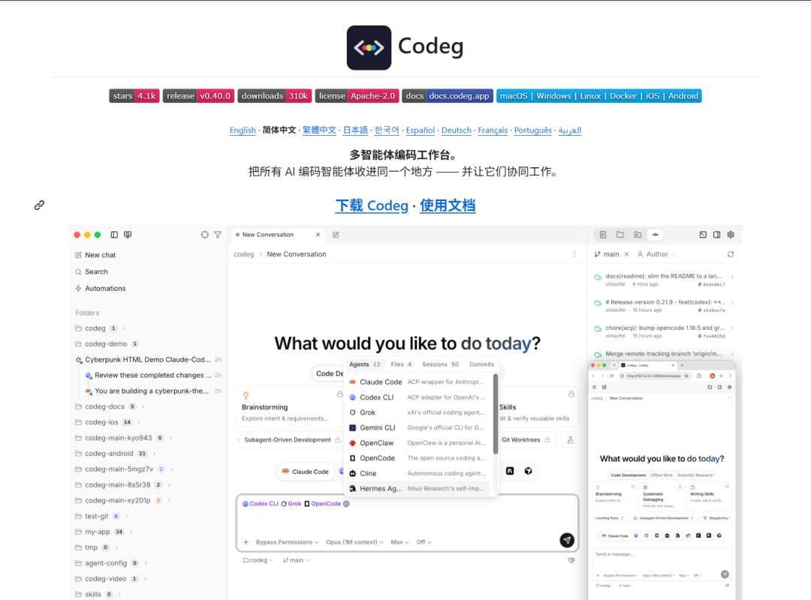
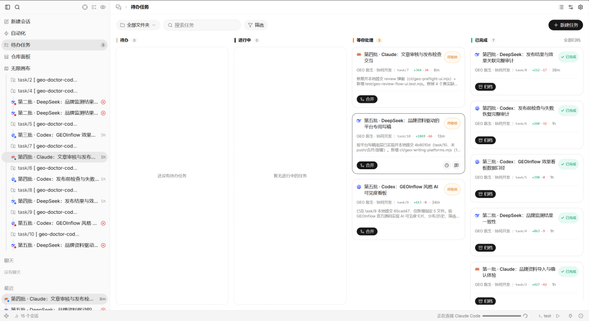

# 三个 AI Agent 一起开发，终于有了“总指挥”

Day 197 · 2026-10-26 · [公众号原文](https://mp.weixin.qq.com/s/7v7Ca6FS2PFDwFpcsTUDzg)

[全部文章](../../README.md#全部文章)

本文目录

- [Codeg 是什么？](#section-1)
- [我准备怎么使用？](#section-2)
- [我给总指挥的提示词](#section-3)
- [多 Agent 不等于自动变强](#section-4)
- [下一步](#section-5)

最近，我基本上在用三个 AI 编程工具协作开发：

- DeepSeek DSH
- Claude Code
- Codex

这三个工具目前都在参与开发我的 GEO 分发系统。

每个平台都有自己擅长的地方。有的适合梳理架构，有的适合快速实现，有的适合检查代码和处理复杂任务。

但只要同时使用多个 Agent，就不可避免地会遇到一个问题：

三方很容易“打架”。

因为它们不在同一个平台里，彼此不知道对方做了什么，也没有一个统一的总指挥。

有时候一个 Agent 刚修改完代码，另一个 Agent 又按照旧版本重新改了一遍；有时候三边同时开发同一个功能，最后不仅重复劳动，还可能互相覆盖代码。

如果完全依靠我手动拆分任务、同步进度和整合结果，又会变得特别麻烦。

这不但没有提高开发效率，反而让我自己成了三个平台之间来回传话的人。

所以今天我专门在网上找了一圈资料，想看看有没有办法设置一个“总指挥”，让我可以在同一个平台里调用不同的 Agent，共同完成开发任务。

还真让我找到了。

这个项目叫 Codeg。

## Codeg 是什么？

Codeg 是一个多 Agent 编程工作台。

它自己并不提供新的大模型，而是把 Claude Code、Codex、DeepSeek Harness、Gemini、OpenCode 等不同的编程 Agent，接入到同一个工作空间里。

你可以在一个界面中：

- 查看和管理不同 Agent 的对话
- 让主 Agent 把任务分配给其他 Agent
- 统一查看文件、代码差异、Git 状态和终端
- 搜索和继续不同 Agent 保存的历史会话
- 让多个 Agent 分别处理不同的开发任务
- 查看每个子任务的执行过程和结果

Codeg 通过 ACP，也就是 Agent Client Protocol，与不同的编程 Agent 通信。

对我来说，它最有价值的地方并不是“同时打开三个聊天框”，而是可以设置一个主 Agent，让它负责拆分任务、安排分工和汇总结果。

这样，多个 Agent 才真正从“三个人各干各的”，变成了一个有组织的开发团队。

项目地址：

GitHub：nobug-project/codeg

Codeg 官方文档

## 我准备怎么使用？

我的计划是让 Codex、Claude Code 和 DeepSeek DSH 共同开发 GEO 分发系统。

当前对话框作为总指挥。

我只需要在这里提出需求，由总指挥理解任务、拆解任务，再根据不同 Agent 的特点进行分配。

比如：

- Codex：负责任务拆解、协调、代码审查、最终验收和结果汇总
- Claude Code：负责架构分析、复杂逻辑和需要较多上下文理解的任务
- DeepSeek DSH：负责明确、可拆分的开发任务，以及高频执行和批量处理

为了防止多个 Agent 互相覆盖，我还会提前设置好协作规则：

- 每个 Agent 只负责自己被分配的模块
- 不允许未经确认修改其他 Agent 正在处理的文件
- 并行任务尽量放进独立的 Git Worktree
- 开始开发前，先确认当前代码版本和任务边界
- 完成任务后，必须汇报修改文件、测试结果和遗留问题
- 已经完成和发布的功能，不再重复开发或重复发布
- 最终代码统一交给总指挥检查、测试和合并

## 我给总指挥的提示词

直接把下面这段话交给 Codex

> 我准备让 Codex、Claude Code 和 DeepSeek DSH 协同开发这个项目。
>
> 当前对话框作为整个项目的总指挥。
>
> 请先读取项目结构、现有代码、Git 状态和开发文档，再为三个 Agent 设置清晰的职责范围和协作规则。
>
> 每次收到我的任务后，先进行任务拆解，再根据不同 Agent 的能力分配工作。
>
> 多个 Agent 不得同时修改同一个文件，不得互相覆盖代码。适合并行的任务使用独立 Git Worktree，存在依赖关系的任务按照顺序执行。
>
> 已经完成、合并或发布的功能，不要重复开发、重复修改或重复发布。
>
> 每个 Agent 完成任务后，必须汇报修改内容、涉及文件、测试结果、风险和下一步建议。
>
> 由当前对话框统一检查各个 Agent 的结果，处理冲突，运行最终测试，并向我汇报整体进度和下一步安排。
>
> 未经确认，不要修改任务范围之外的代码，也不要删除其他 Agent 或用户已有的修改。

## 多 Agent 不等于自动变强

我现在越来越明显地感觉到，多 Agent 协作真正困难的地方，不是接入多少个模型，而是如何分工。

如果没有清晰的任务边界，三个能力很强的 Agent 同时工作，也可能只是把混乱放大三倍。

总指挥真正需要解决的是四件事：

- 谁负责什么
- 哪些任务可以并行
- 哪些文件不能同时修改
- 最终由谁检查和合并

这和现实中的团队管理其实非常相似。

模型能力再强，如果没有任务拆解、职责边界、版本管理和验收标准，最后依然会变成一群能力很强、但彼此不知道对方在做什么的人。

## 下一步

接下来，我会先在 GEO 分发系统中测试这套协作方式。

我的目标不是为了多用几个 AI 工具，而是建立一套真正稳定的多 Agent 开发流程：

- 需求由我提出
- 总指挥负责拆解
- 不同 Agent 分工执行
- 任务过程可以查看
- 代码修改彼此隔离
- 最终结果统一检查和合并

如果这套流程能够真正跑通，那么以后开发大型项目时，我就不需要在三个平台之间反复传话了。

我只需要管理一个总指挥。

剩下的任务拆解、分配、执行、检查和汇报，都可以在同一个工作空间里完成。

这才是我理解的多 Agent 协作：

不是同时打开三个 AI，而是真正组建一支能够分工、协作和交付结果的 AI 开发团队。

---

上一篇：[No.196 2026 GEO 白皮书：AI 搜索优化的格局、商业模式与收费全拆解（20 万字）](day-196.md)

下一篇：[No.198 一分产品是否大于十分流量](day-198.md)

[返回目录](../../README.md#全部文章)
