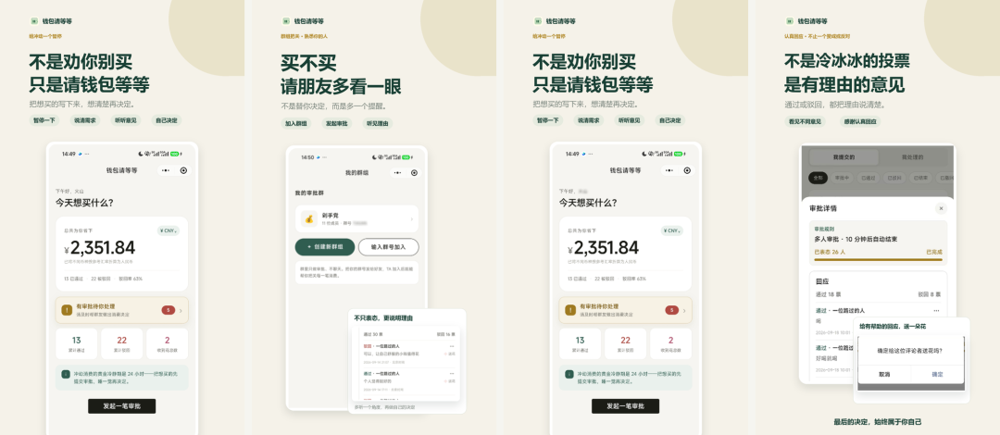

# 一个小程序爆火的故事

Day 199 · 2026-10-28 · [公众号原文](https://mp.weixin.qq.com/s/acJRRdL-KxHacQYMfNZOsA)

[全部文章](../../README.md#全部文章)

本文目录

- [一个爆火产品的诞生](#section-1)
- [1. 好胜，尤其是「差一点点」](#section-2)
- [2. 好奇，以及关系要「对一下」才成立](#section-3)
- [3. 象征性的权力，和交出决定的轻松](#section-4)
- [如果要自己做一个，我会怎么过一遍](#section-5)

## 一个爆火产品的诞生

最近又火了一个小程序：叫做钱包请等等。每次有这样爆火的小程序，我都在想为什么会火，如果我要做一个小程序，可以借鉴的地方是什么。

*钱包请等等 · 应用宝官方预览*

*钱包请等等 · 应用宝官方预览*

每过一段时间，微信里就会冒出一个东西：跳一跳、合成大西瓜、羊了个羊、各种人格测试，再到「钱包请等等」。

玩法不像，火起来的样子却像——群里突然都在聊，你点进去，又转给别人。

很多人会从玩法、营销、运气去解释。这些都重要。

可我总想更深一步探索：一个小程序要爆，心理层面大概要备齐什么？我们如果自己做一个，先抓住哪个最重要的因素，才「有可能」火——不是保证会火，但有潜力。

目前我很确定的是，爆款很少靠「功能很全」。而是很准地碰到了一种人人差不多都有的心理缺口，再把缺口做成几秒就能完成的动作。

### 缺口怎么定义呢

是不服输、熟人面前怕落后、想知道自己和别人是谁、想管一点事或被帮着做决定、想占一点无伤大雅的便宜……我想了想，最重要其实是：能不能一句话说清用户为什么愿意点第二次、为什么愿意发给别人。

比如 SBTI 好友匹配，转发的理由就是查看和好友是否匹配；羊了个羊，就是想试试自己能否通过之类的等等……

如果一句话说不清，后面堆再多分享按钮也费劲。

说得清的，小程序形态反而像放大器——它活在聊天里，零安装，关系链现成。同一根心理弦，放在要下载的 App 里，传播成本完全不同。所以我觉得做产品之前与其先想「我能做什么玩法」，不如先想：如何让人停下刷屏、点进来并愿意转发。

我大概总结了几类心理因素，一点浅薄的看法，大家可以参考着看。

## 1. 好胜，尤其是「差一点点」

跳一跳（2017 年底上线）玩法简单：长按蓄力跳跃，掉下去就结束，然后是好友排行榜。它有微信首屏入口的红利，学不来；但去掉入口，心理钩子仍在——熟人圈里的名次。

你未必真在乎分数，群里有人晒了四百多，你就会想自己怎么才一百多。

外挂和代练后来冒出来，说明有人玩的不是手感，是榜上那一行。

*跳一跳实机*

*跳一跳实机*

*跳一跳结算界面*

*跳一跳结算界面*

*当年淘宝上的跳一跳代练*

*当年淘宝上的跳一跳代练*

羊了个羊（2022 年 9 月）把好胜拧得更紧。

第一关送分，第二关极难，卡关看广告、分享换道具，还有省份通关榜。它不像跳一跳慢慢爬分，更像把人按在失败里摩擦。我倾向于主要归到「近失」：永远像差一把，愤怒和希望缠在一起，「再来一次」显得合理。吐槽也是燃料——「真有这么难？」围观者被好奇心拽进来。

失败本身成了可转发的内容，这点很多「好玩但不虐」的产品做不到。

*羊了个羊第一关*

*羊了个羊第一关*

*羊了个羊第二关叠层*

*羊了个羊第二关叠层*

*槽位已满 · 看广告复活*

## 2. 好奇，以及关系要「对一下」才成立

人格测试、「测测你和 TA」几乎是常驻物种。

早年有默契考验类小程序：你先答，邀好友来猜，出证书和排行。后来戏仿人格测试 SBTI（2026 年 4 月）一夜刷屏，标签故意自嘲；很快长出好友 PK、CP 匹配。有人再做成「必须输入好友结果才能看完整报告」——裂变写进规则里。

*SBTI 测试首页*

*SBTI 测试首页*

点开的那一下，多半是好奇：我想知道自己多离谱，也想知道你是什么。可结果若变不成一句能转的话、一张能晒的图，好奇很快熄。标签把暧昧关系压成短句；缺第二个人对一下，意义悬着。

*SBTI 可分享结果卡*

*SBTI 可分享结果卡*

*SBTI 好友／CP 匹配*

*SBTI 好友／CP 匹配*

所以这根弦其实是两层：表层好奇，深层是关系定位和轻量展示。社交不是事后贴上去的属性，是结果要「成立」时必需的第二个人。

做这类东西时，单人可玩往往不够；要问——结果是否天然需要另一个人才能闭合？若需要，传播就有机会长在产品上，而不是运营临时喊的转发。

## 3. 象征性的权力，和交出决定的轻松

「钱包请等等」：想花钱，先写理由和替代方案，让亲友或陌生人投通过/驳回。开发者说过，有人真想省钱，有人享受「批折子」。

*钱包请等等消费广场*

*钱包请等等消费广场*

审批端是很轻的权力——管不了银行卡，却能盖章，安全、无责，还带点优越感。

申请端常常反过来：把「该不该买」挪到外面，听人说两句；熟人碍面子，陌生人反而好用。广场上的奇葩单，又喂旁观欲。三股缠在一起：象征管理欲、决策外包、纠结的可观赏性。

贩卖的常常是象征，不是实权。真冻账户、真交财政大权，人反而不来。

象征满足若能批量生产（每人每天可批很多单），参与才密得起来。

做之前可以问：我给用户的「权力感」或「被帮着决定的轻松」，是不是足够轻、足够可重复？

## 如果要自己做一个，我会怎么过一遍

说了这么多，一个小程序，我觉得重点要看以下几点：

- 先看那句话还在不在。 用户为什么点第二次？为什么愿意发给别人？
- 再看动作沉不沉。 点开就要有反馈，几秒内能再来一次。小程序吃的就是轻；流程一旦做成重 App 的样子，形态红利就先丢一半。
- 还有没有「缺一块」。 差一把过关、缺一个好友才出报告、缺一票才安心下单——这种缺口会逼人回来，也会逼人拉人。体验完整得太早，常常停在自嗨。
- 满足轻一点，往往比做真更有效。 标签可以不准，审批可以作废，通关可以很难。太真、约束太重，那点爽感会被心理成本盖住。
- 还有一件事，做的时候容易忘：情绪最好能从两头出去。 通关、配对、盖章通过是爽；骂、笑、纠结、围观也是出口。羊了个羊被骂着传开，测试结果被笑话着传开，审批单被围观着传开。只有赞美的东西，路人未必愿意帮你传。

---

上一篇：[No.198 一分产品是否大于十分流量](day-198.md)

下一篇：[No.200 一人公司纪实](day-200.md)

[返回目录](../../README.md#全部文章)
