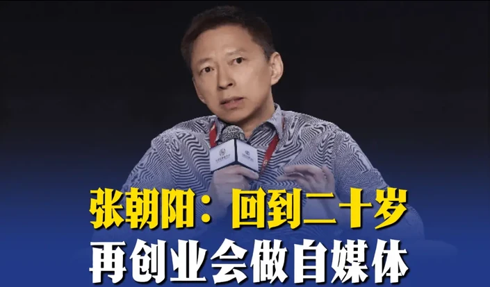

# 论为什么要做自媒体

Day 201 · 2026-11-02 · [公众号原文](https://mp.weixin.qq.com/s/3jZS2xaZ0MYPI8JDHGSv-w)

[全部文章](../../README.md#全部文章)

张朝阳说了一段很精辟的话：视频自媒体是这个时代给普通人极低成本获得影响力和传播力的历史性机会。（注意：是历史性机会）

假如他回到二十岁，再创业会做自媒体。

但凡对历史有点了解就会知道，自媒体是几千年以来个人传播力最强、成本最低的事物。它是科技发展带来的真正杠杆，是一个人能撬动的最大力量，也是你提升自己、在行业里占据位置的最强抓手。

在过去，一个人、一个产品想被看见，真的太难了。

要么依附明星、大佬、报纸、电视台，要么先攒出足够多的钱去买版面、买时段、买渠道。你的声音从来不是你的，是系统允许你借来的。印刷术让思想可以复制，但出版权仍在少数人手里；广播和电视让声音和影像飞进千家万户，可话筒和镜头永远只掌握在极少数人手里。普通人只能做观众，不能做主角。

自媒体第一次把这个结构反过来了。你不再需要先被机构认可，再被允许发声；你可以直接对着镜头说话，算法会根据真实互动决定要不要把你推给更多人。

门槛低到几乎只剩两样东西：一部手机，和你愿意持续开口的勇气。

这不是天上掉馅饼这是什么？

很多人刚拍视频，觉得四五百播放量很少，看上去上轻飘飘的，可放到现实的一条街里，你去摆个摊，站都站不下。

没有成本、只有收益的事情，这样的事去哪里找？你唯一要付出的只有时间以及克服自己脆弱的内心。时间在某些人眼里是最贵的，但对刚起步、口袋里没有钱的人来说，这简直是一本万利的生意，夜里打着灯笼都找不到。

你唯一真正在付出的，是把时间从“刷别人”改成“被别人刷”，是从被别人掠夺注意力变成你掠夺别人的注意力，以及克服那点怕被看见、怕被评价的脆弱。

---

上一篇：[No.200 一人公司纪实](day-200.md)

下一篇：[No.202 如何给个人博客做GEO](day-202.md)

[返回目录](../../README.md#全部文章)
