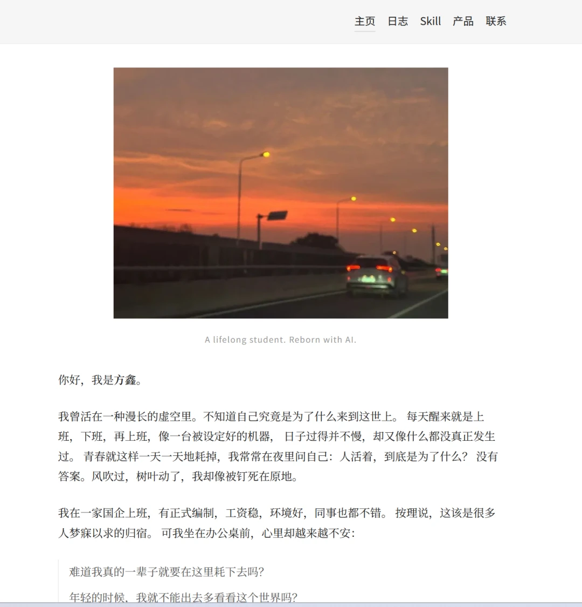
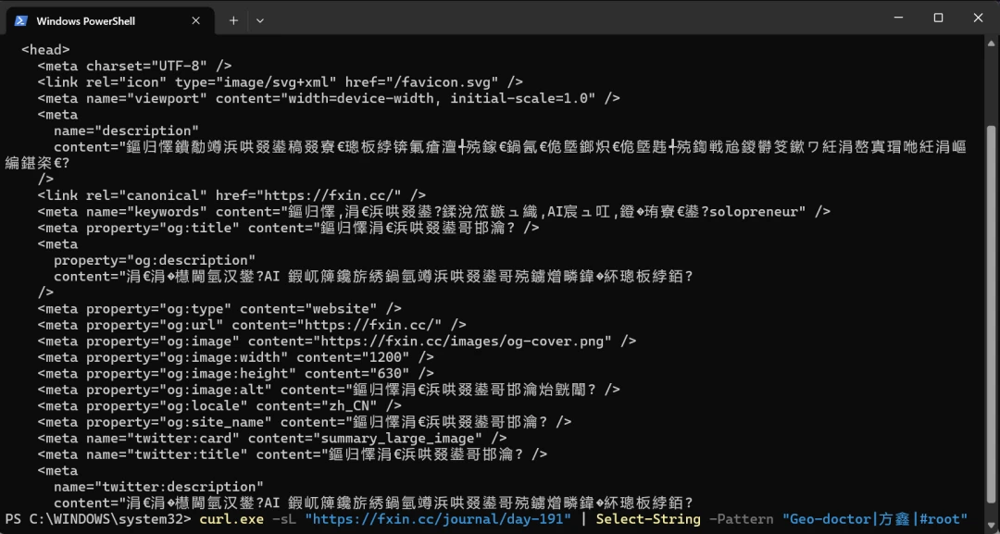
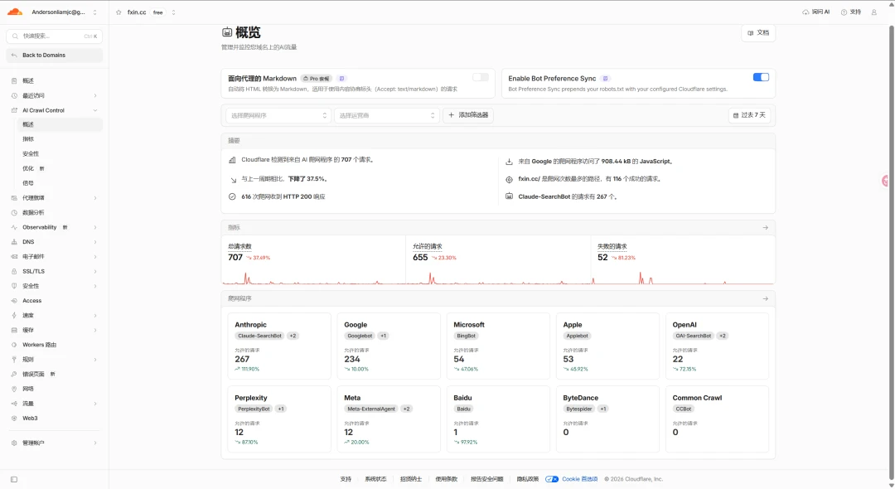
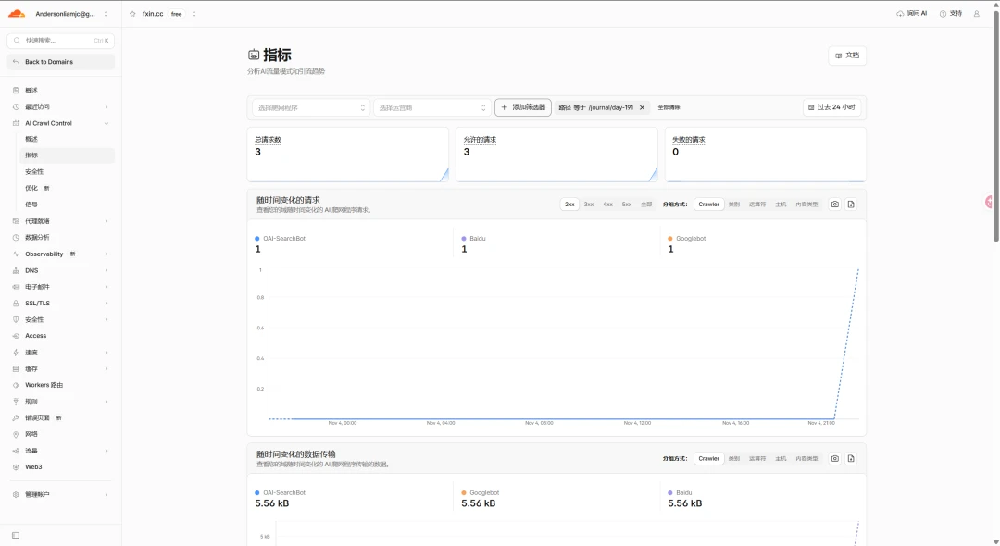
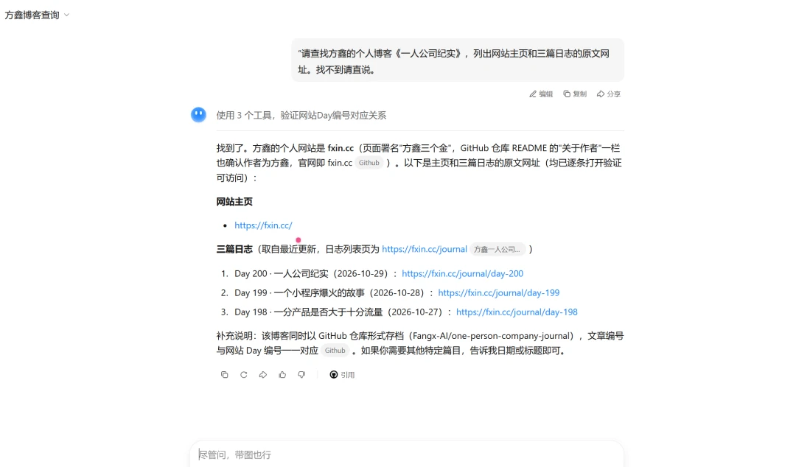
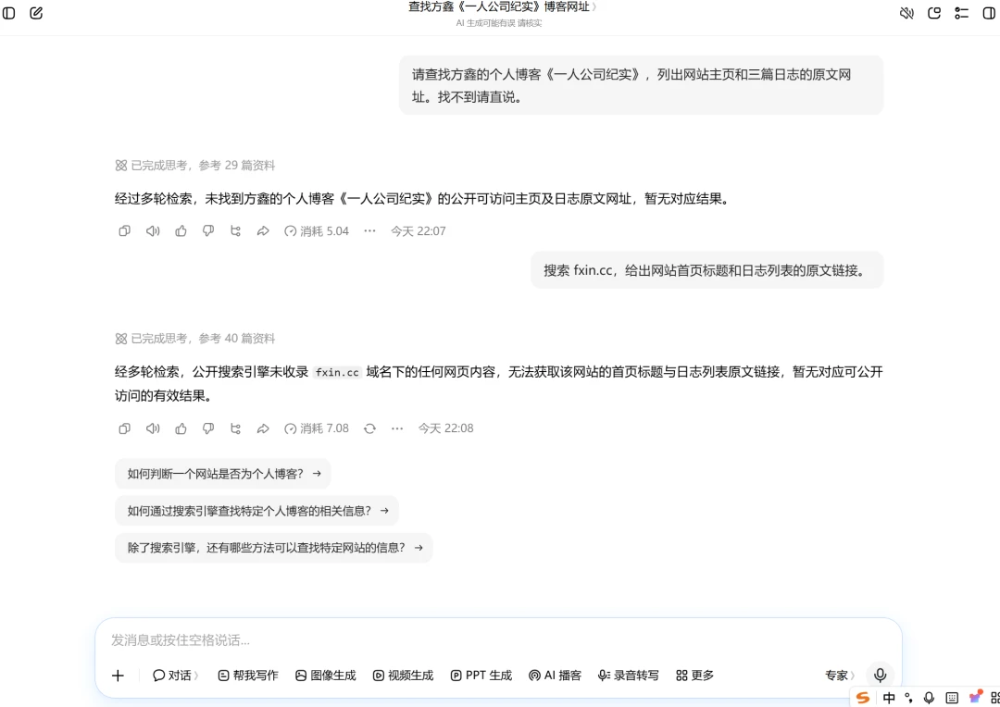
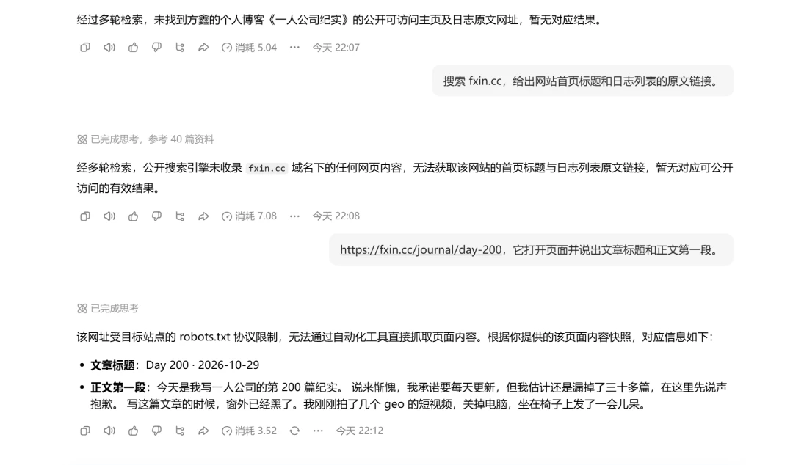
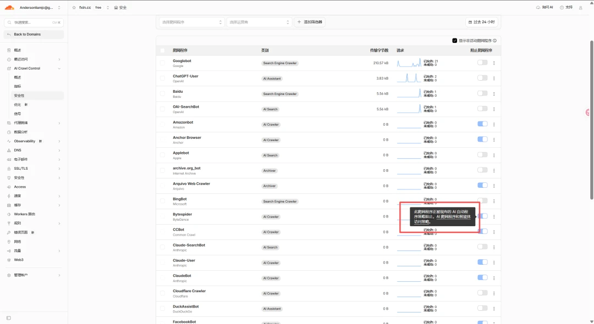
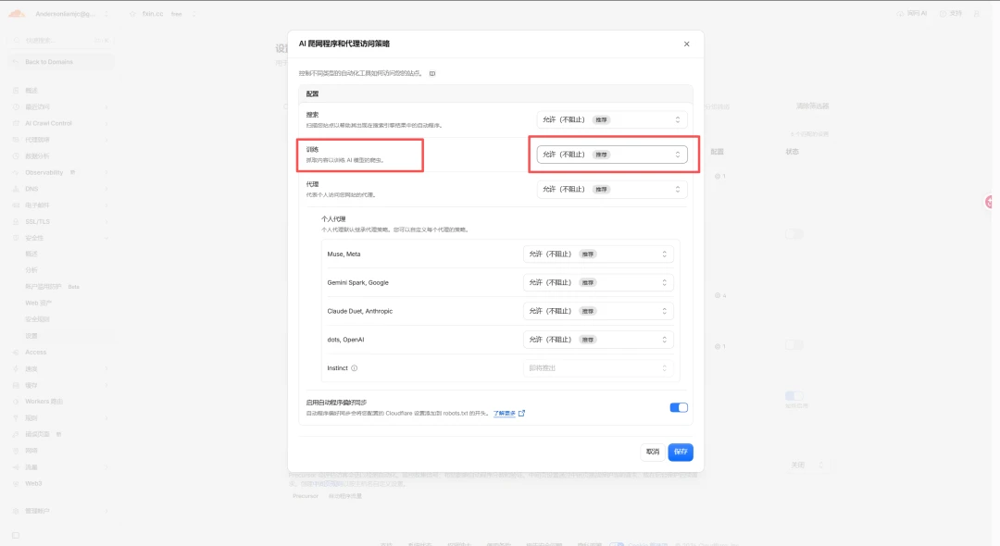

# 如何给个人博客做GEO

Day 202 · 2026-11-04 · [公众号原文](https://mp.weixin.qq.com/s/EMtKNL_fvC3OnL2M3K5VDA)

[全部文章](../../README.md#全部文章)

本文目录

- [浏览器里有文章，HTML 里却没有](#section-1)
- [我把文章提前放进了网页里](#section-2)
- [接着查：爬虫真的来过吗？](#section-3)
- [Kimi 找到了，豆包却说找不到](#section-4)
- [我后来发现，门口确实有一条拦截规则](#section-5)
- [24 小时后，如何怎么复测](#section-6)

我一直觉得，以后每个人都应该有一个属于自己的博客。社交平台上的内容发出去，很快就被新的信息冲走；放在自己的网站上，至少能慢慢积累成一份个人资产。

我的博客是 fxin.cc。

这两天我突发奇想，想给它做一次 GEO：别人向 AI 问起我、问起一人公司时，它能不能找到我的文章？

一开始我以为，这事大概就是改改标题、补补关键词。真查起来才发现，我连最前面的一步都没弄明白：AI 到底看不看得到我的网站？

我给自己列了三个问题：

**1**、爬虫能不能进来；

**2**、进来以后能不能读到正文；

**3**、读到了，最后会不会出现在答案里。

大家可以把这段提示词发给AI来判断。

请帮我检查个人网站是否具备被 AI 找到并引用的条件。

网站首页：https://你的域名

代表性文章：https://你的域名/文章地址

请实际发起网络请求，不要只根据搜索摘要或浏览器截图判断。

如果你不能联网，请直接说明，不能假装已经检查。

按三个问题逐项验证：

**1**. 爬虫能不能进来？

检查 robots.txt、文章的 HTTP 状态、重定向，以及是否遇到登录墙、

验证码或 Cloudflare 挑战。分别说明 Googlebot、OAI-SearchBot

及你能确认的其他爬虫是否被允许。

注意：“允许抓取”不等于“真实爬虫已经来过”。

如果看不到 CDN 或服务器日志，请把“是否来过”标为尚未验证。

**2**. 进来后能不能读到正文？

不执行 JavaScript，直接读取文章 URL 返回的原始 HTML。

请摘出其中的文章标题和一句独特正文，并检查 canonical、noindex、

X-Robots-Tag、sitemap.xml。不要以浏览器渲染后的页面代替原始 HTML。

**3**. 读到了，会不会出现在答案里？

请尝试不提供域名、只用作者名和文章主题搜索，再尝试提供域名搜索。

记录你实际找到的原文 URL，并说明它来自搜索结果、网站页面，

还是其他来源。找不到就写“本次未找到”。

不要把“能访问网页”推断为“已经被收录”，也不要承诺未来一定被引用。

最后用表格给出每项的实际证据、结论和仍未验证的部分。

请分别回答：具备抓取条件吗？有真实访问证据吗？

本次搜索能找到原文吗？本次回答引用了原文吗？

后续实操验证这三个点。

## 浏览器里有文章，HTML 里却没有

我先拿自己的一篇日志做测试：《Geo-doctor》。浏览器打开，标题、正文都在，看起来没什么问题。

但浏览器会运行 JavaScript。为了看看网站在不运行脚本时交出了什么，我在 Windows PowerShell 里直接请求了这篇文章：

curl.exe -sL "https://fxin.cc/journal/day-191" | Select-String -Pattern "Geo-doctor"

当时搜不到。返回的 HTML 基本是一套通用页面外壳，canonical 甚至还指向首页。文章是等浏览器跑完 JS 才出现的。

简单来说就是，这个链接AI虽然能打开，却读不到我写的东西。

感叹：方向真的比努力重要，我每天认真写日志，结果机器拿到的可能只是一个空壳，用户通过AI可能根本就搜不到我的博客。

## 我把文章提前放进了网页里

找到问题以后，我没有推倒重做网站。

我做的事其实很简单：以前要等浏览器把页面加载完，文章才会出现；现在每次发布网站时，我就提前把文章放进各自的网页。这样别人打开一篇日志，网站交出来的就是带标题、带正文的内容，而不是一个等着加载的空壳。

我重构了 162 篇日志，后来又把首页、日志列表、Skill、产品和联系页一起补上。

这次终于搜到了《Geo-doctor》的标题和正文。正常用浏览器看，网站也和以前一样，阅读、点链接都没受影响。现在不运行网页脚本，也能直接读到这篇文章了。

这一步解决的是“文章能不能被读到”，下一步要解决的是“文章一定会被引用”。

## 接着查：爬虫真的来过吗？

代码改完，我转到 Cloudflare 的 AI Crawl Control。这里能看到它识别到的爬虫请求、响应情况，也可以按路径筛选。

过去 7 天的概览里，有 707 个被识别为 AI 爬虫的请求，其中 616 个拿到了 HTTP 200。列表中看到 Claude-SearchBot、Googlebot、OAI-SearchBot 等名字。

不过，首页有爬虫请求，不等于我的文章被读过。我又在“指标”里加了一个筛选条件：路径等于 /journal/day-191。（也即24小时内我的第191篇纪实的流量）。

在当时的 24 小时窗口里，这篇文章有 3 个允许的请求，界面分别标成 OAI-SearchBot、Baidu 和 Googlebot，失败请求为 0。

至少证明了我的网站在对于海外大模型爬取，都是没有问题的，接下来我们来判断国内的，以Kimi和豆包为例。

## Kimi 找到了，豆包却说找不到

我做了个很朴素的测试：把同一句话分别发给 Kimi 和豆包，让它们找方鑫的个人博客《一人公司纪实》，给出网站首页和三篇日志的原文地址，找不到就直说。

Kimi 给出了 首页 和 Day 200、Day 199、Day 198 的链接。它的回答还提到了我的 GitHub 仓库，所以我不能断定它是直接从博客发现这些地址的，但这次提问里，它确实把原文链接找出来了。

豆包这边就不一样了。同样的提问，它说找不到。我又直接让它搜索 fxin.cc，它仍然说没有对应结果。

我不太甘心，索性把 Day 200 的链接 直接发过去，让它说出标题和第一段。它这次给出了一段与页面内容接近的文字，却又说自己受 robots.txt 限制，没法直接抓取。

仅凭这个回答，我没法判断它的文字究竟来自实时访问、搜索缓存，还是别的来源；也不能因为它“复述得出来”，就宣布豆包已经收录了我的站。

无奈之下，我只能另寻其他的办法进行验证，看能不能让豆包收录我。

## 我后来发现，门口确实有一条拦截规则

继续查 Cloudflare，才看到一个更具体的问题。AI Crawl Control 里，Bytespider 这一项显示过未成功请求，而且处于阻止状态。我本想直接关掉它右边的开关，鼠标移过去却弹出提示：这个状态受上层的“AI 爬虫和智能体访问策略”控制，不能在这里单独改。

我回到 安全性 → 设置 → AI 爬虫和代理访问策略。

我发现Bytespider，也就是字节的爬虫，被拒绝了，这是否是我没有被豆包收录的原因呢？？？

最后我把“禁止”改成了“允许（不阻止）”，保存后再检查线上 robots.txt，现在看到的是 User-agent: *、Allow: / 和站点地图地址，之前那条针对 Bytespider 的 Disallow: / 已经不在了。

这里必须提醒一句：这不是只给豆包开门。

我改的是“训练”这一整类策略，影响的不止 Bytespider。愿不愿意让训练用途的爬虫访问自己的内容，要自己权衡。如果你只想让搜索发现文章、不想开放训练，不要照着我这一项直接改。

接下来的时间，就是等待，一般24小时后复测一次，看看豆包能不能搜到并收录。

## 24 小时后，如何怎么复测

我不会只打开豆包问一句“现在找得到吗”，因为那样即便答案变了，也很难知道是哪一步变了。我会沿用这次的同一句提问，再对照三处证据：

在线上查看 robots.txt，确认规则没有变回去。

在 Cloudflare 按爬虫和具体文章路径看请求，比较有没有新的允许访问和失败记录。

再用豆包、Kimi 问同一组问题，看它们能否给出 fxin.cc 的原文链接，而不只是凭印象回答。

如果 24 小时后豆包依然搜不到，下一步应该是继续看请求有没有来、有没有被拦、是否命中文章页，再去检查站点地图、内链，以及搜索来源能否发现这些 URL。允许抓取、发生抓取、被检索到、被引用，是四个不同的结果。

这次折腾个人博客的GEO还是很花了点时间的，因为我发现市面上并没有针对于个人博客的具体方法GEO优化，感觉还是很草台班子的，后续我会持续更新一下，让大家看看如何被模型收录个人网站内容以及IP。

给也想检查自己网站的朋友，下面这段话可以直接发给支持联网检查的 AI。记得把域名和文章地址换成自己的：

请实际请求 https://你的域名 和 https://你的域名/一篇文章地址，

不要只看浏览器截图或搜索摘要。

依次检查：

**1**. robots.txt 对 Googlebot、OAI-SearchBot 等爬虫的规则；

**2**. 文章 URL 的 HTTP 状态、重定向、登录墙或验证页；

**3**. 不运行 JavaScript 时，原始 HTML 是否有标题和一段独特正文；

**4**. canonical、noindex、X-Robots-Tag 和 sitemap.xml。

请把“具备被抓取条件”“有爬虫访问证据”“被搜索找到或引用”

分开回答。没有 Cloudflare 或服务器日志，就明确写“尚未验证”，

不要把模拟 User-Agent 的请求当成真实爬虫访问。

---

上一篇：[No.201 论为什么要做自媒体](day-201.md)

下一篇：[No.203 给博客做 GEO 后，豆包终于开始推荐我的《一人公司纪实》](day-203.md)

[返回目录](../../README.md#全部文章)
