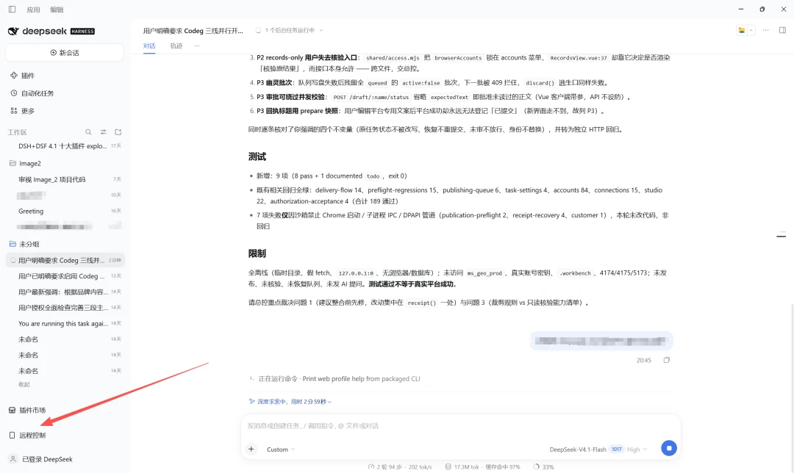
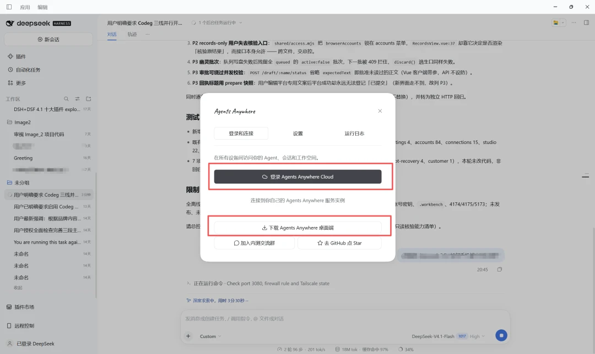
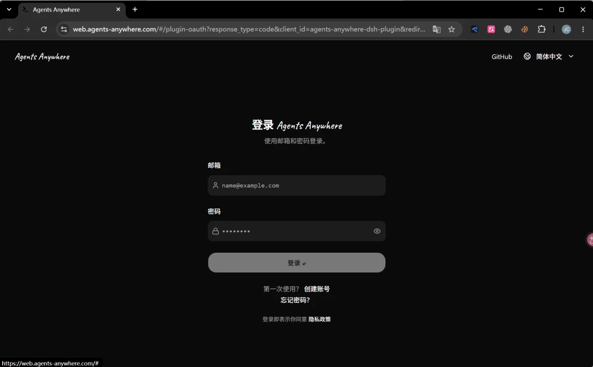
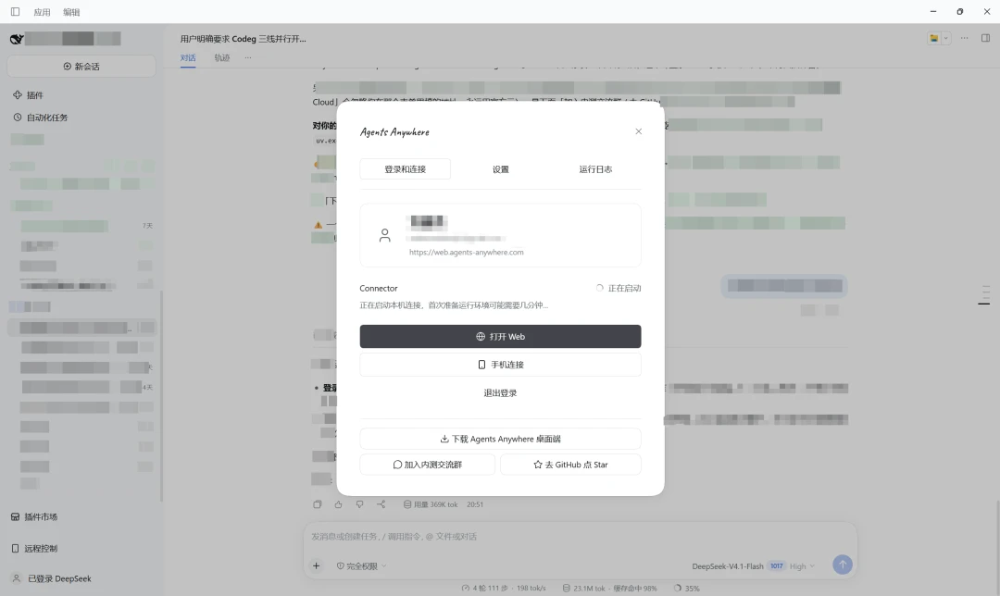
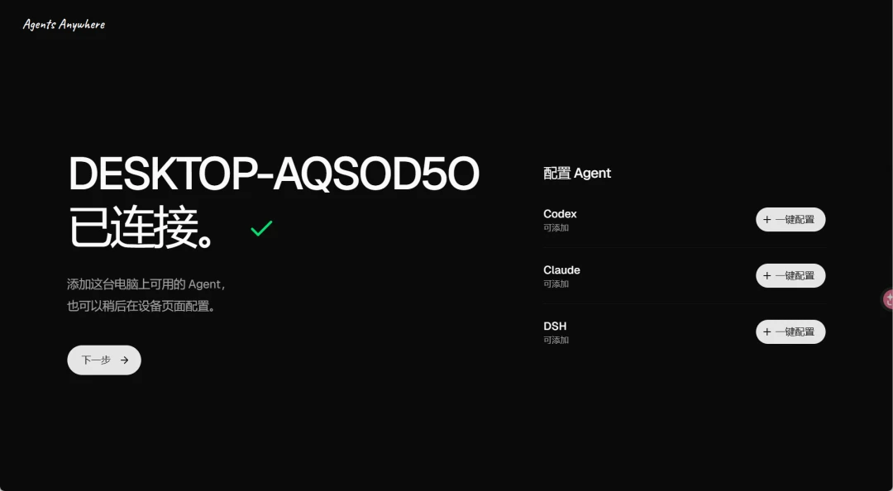
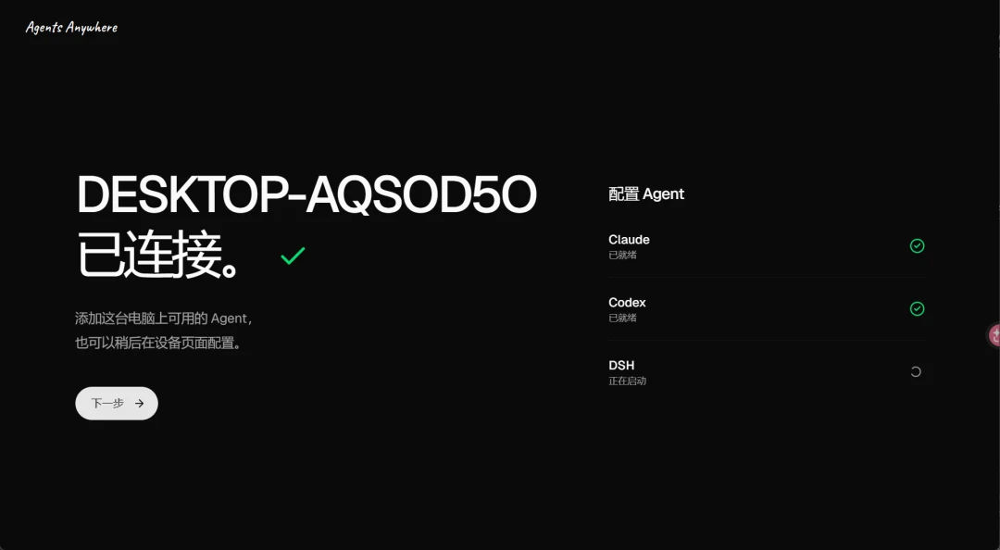
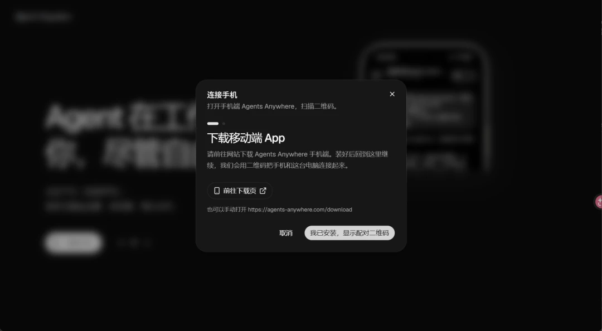
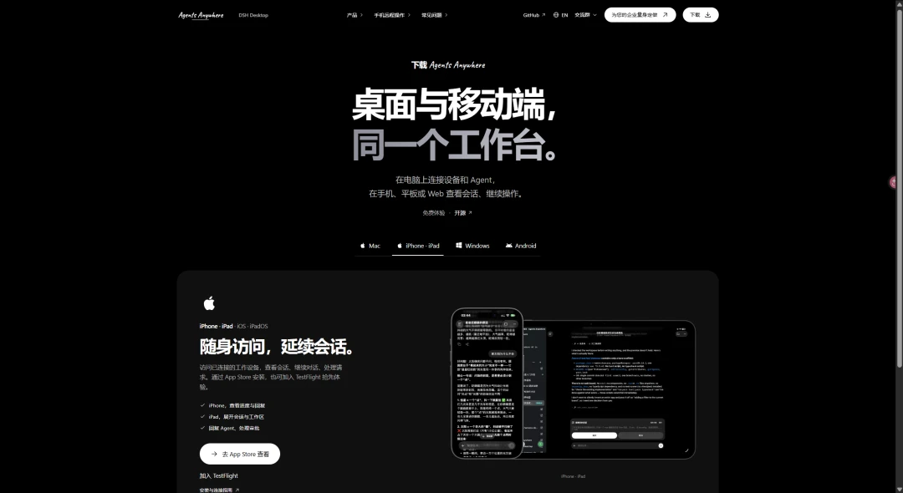
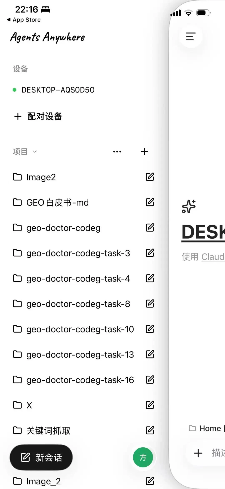
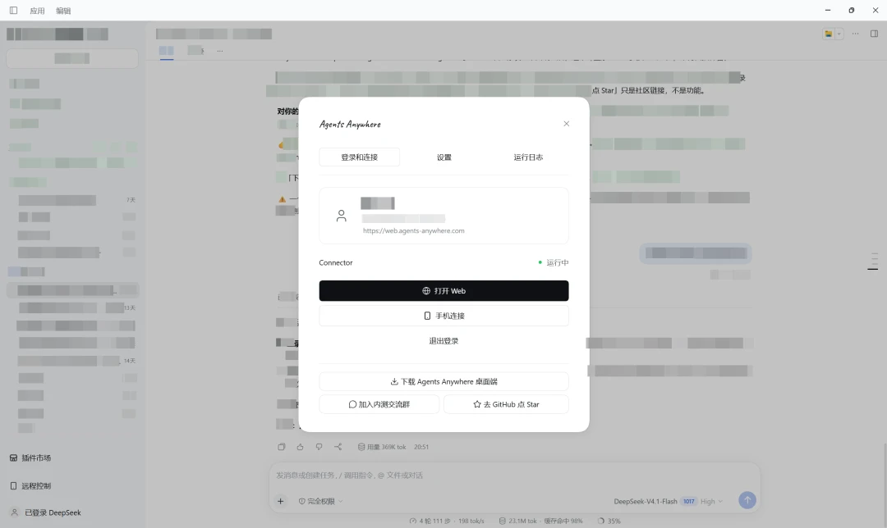

# DeepSeek如何通过手机操作

Day 204 · 2026-11-12 · [公众号原文](https://mp.weixin.qq.com/s/9PeX6vcS83EiLvrye3Mekg)

[全部文章](../../README.md#全部文章)

最近真的很喜欢用DSH，用着用着，就想把它接到手机上。不坐在电脑前的时候，也能打开看看。

今天试了一遍，手机端连上了。我把过程记下来，想试的朋友可以照着找入口。

先说清楚：这次不是把完整的 DSH 装进手机，而是通过 Agents Anywhere，把手机和电脑上的 Agent 连接起来。

## 第一步：找到远程控制入口

先点击 DSH 左下角的「远程控制」。

打开后有两个入口：

登录 Agents Anywhere Cloud：从 DSH 里直接连接云服务，不需要另外安装 Agents Anywhere 桌面端。

下载 Agents Anywhere 桌面端：跳转到官网，安装独立软件，再通过它管理连接。

我本来打算两个都试试，这次先走第一个 Cloud 入口。下面记录的也都是这条路线。

## 第二步：登录账号，连接电脑上的 Agent

点击后会打开注册页面，没有账号的话，先注册并登录。

登录后回到 DSH，可以看到 Connector 正在启动。页面提示，首次准备运行环境可能需要几分钟。

我这里也等了一会儿，电脑才连上，看到「正在启动」先别急。

这一步可以添加电脑上可用的 Agent，页面里列出了 Codex、Claude 和 DSH。既然都到这里了，我干脆一起配置。

分别点击右侧的「一键配置」，等待状态变化。下面这张截图里，Claude 和 Codex 已经就绪，DSH 还在启动中。

这一步比我想象中省事。我这次没有手动填写配置，主要就是点一下，等它完成。

当然，这是我这台电脑上的操作过程。你那边有哪些 Agent 可用、是否需要补充配置，还是以实际页面为准。

## 第三步：安装手机端，再扫码配对

电脑连接好后，进入「手机连接」。页面会先提示下载 Agents Anywhere 手机端。

点击「前往下载页」，选择自己手机对应的版本。我给自己的安卓和 iOS 手机都装了一个。

安装完成后，回到连接页面，点击「我已安装，显示配对二维码」，再用手机端按提示扫码配对。

这里扫的是你自己电脑上显示的配对码，不是教程里的图片。配对二维码也别发到公开文章或群里。

## 第四步：确认手机里能看到电脑和项目

配对完成后，手机端也接进来了！

我在手机上看到了这台电脑，旁边是绿色状态点，下面还列出了电脑上的项目。

再回到电脑端，Connector 显示「运行中」，窗口里也保留着「打开 Web」和「手机连接」两个入口。

到这里，这次连接就完成了。整条路线是：DSH 远程控制 → 登录 Cloud → 配置 Agent → 安装手机端 → 扫码配对。

我这次先确认了手机能连上、能看到设备和项目。至于长时间使用稳不稳定、换个网络以后怎么样，还要继续用一段时间再说。

不过，能在手机上看到自己电脑里的项目，这一步已经让我挺开心了。

---

上一篇：[No.203 给博客做 GEO 后，豆包终于开始推荐我的《一人公司纪实》](day-203.md)

下一篇：[No.205 独居](day-205.md)

[返回目录](../../README.md#全部文章)
