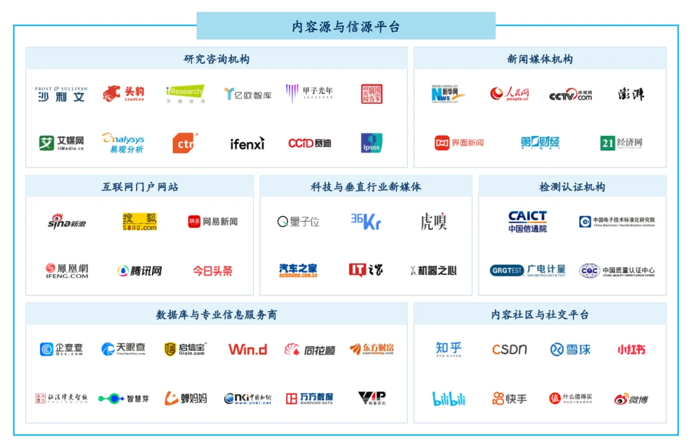
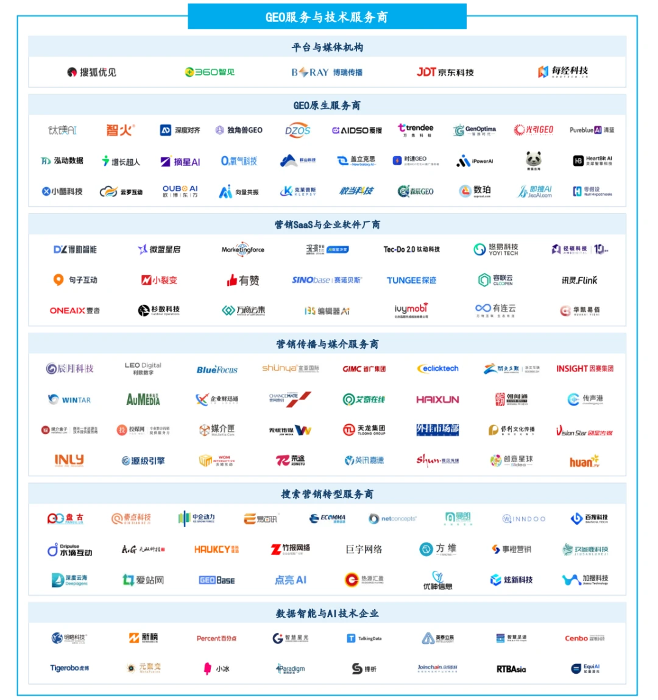

# 论GEO行业的前景

Day 206 · 2026-11-17 · [公众号原文](https://mp.weixin.qq.com/s/0uOmbA1mG-zVtnVH-EqF3A)

[全部文章](../../README.md#全部文章)

昨天下班的时候，手机刚好没电了。我也懒得充，索性走路回去，正好想一想最近一直没想明白的事：GEO 到底该怎么做下去？

这段时间，我自己改博客、测豆包，也开始考虑怎么给客户提供服务。

做得越具体，反而越能感觉到这里面的不确定。

文章发出去了，AI 就一定会引用吗？今天推荐了，下周还会不会推荐？客户花了钱，我们到底拿什么验收？

GEO 给我的感觉，有时候像一个黑箱。

我们能看到提问和答案，也能看到一部分搜索来源，但很难完整解释：为什么这次选了这篇文章，下一次又换了？

拿自己的博客来说，能打开网页、能读到正文、能搜到链接、最后在回答里推荐我，是几件不同的事。我之前折腾了那么久，也是在一点点把它们分开。

自己做实验，没找到就继续查。

但换成客户，这个问题就没那么轻松了。

客户不会只关心“文章发了没有”，他更想知道：有没有人通过 AI 找到我？有没有带来咨询？这笔钱花得值不值？

如果我交付的是十篇稿件，客户以为自己买到的是稳定推荐，那从一开始，双方对这件事的理解就是错开的。

我之前容易把 GEO 想成：找到模型喜欢的内容形式，多发一些文章，让它更容易提到你。

可即便某一种写法、某一个平台，短期内能带来更多提及，我也不能因此认定，这套办法能一直有效。（因为信源在不断的变化，而且国内厂商有明显的喜爱偏好）

以豆包为例，豆包近乎8成信源来自于抖音，如果是涉及到地图的，那么就会引用携程（应该是和携程有合作）。豆包几乎不会引用公众号等平台的内容，这不单单是字节对于自家品牌的保护，更是国内封闭的产品生态导致豆包并不能高效的搜寻并拿到其他平台的资讯（通过调用API）。

所以国内的GEO我其实也是认为应该是针对性平台的做。

再者，模型在不断的变聪明，检索来源、产品规则、问题问法，甚至一次回答的波动，都可能影响结果。

可GEO又是一个比较追求短期效果的行业，这是非常矛盾的，真正的GEO就应该是长期的维护。

如果一套服务的价值，只建立在某个暂时有效的技巧上，那我该怎么向客户解释它失效的那一天？

所以编造案例、堆砌排名、用虚假信息诱导推荐这条路。就算短期有用，长期来看也是没有长远价值的，必然伴随着大量的扯皮拉筋。

还有一个比较关键的问题，也是GEO面临的最大挑战，平台是否会直接下场GEO。

如果平台自己做广告，GEO 还有位置吗？

这是我走路时想得最多的问题。

平台既掌握 AI 入口，又有自己的商业化方式。如果用户问完问题，就能在平台里看商品、下单，那我们这些在外面研究内容、研究信源的人，还能做什么？

这种担心并不是完全没有依据。

阿里巴巴在 2026 年 5 月的一份官方公告中，介绍了千问与淘宝商品目录的连接，以及通过自然语言浏览、比较和下单的购物体验。来源：阿里巴巴官方公告

OpenAI 也在推进 ChatGPT 广告。不过按照它的官方说明，广告是单独标注、与回答分开的付费展示，广告主不能因此修改或影响ChatGPT的回答。来源：OpenAI 广告说明

豆包或许在未来也会在回答里大量推荐抖音电商的东西，甚至直接向大家收费，谁给的钱多，谁推荐的就越狠，我认为这并不是不可能发生的事情。

以后自然回答、付费展示、平台内交易，可能会同时存在。

至于这会不会挤压独立服务商，甚至让某些做法失去价值，我现在没有确定答案。这是我的担忧，还不能当成已经发生的结论。

但不管怎么样，这个行业目前是处于增长的状态，这是毋庸置疑的。

下面两张，是我整理资料时存下来的分类图。仅供大家参考一下。

上面这张把内容来源分成了媒体、研究机构、行业网站、社区等类别。

我根据这个，让我的Grok Bot去自动化调研这些公司，给我一篇十万字的报告，我拆了很多篇内幕文章出来，后续我会慢慢发出来，这样结构也会清晰一下。

但是我仍然觉得GEO是可行的，我说说我的看法。

**1**、GEO同时兼顾To B和To c的属性，市场覆盖面广。

**2**、GEO同时兼顾代理、代运营、系统售卖等多个盈利渠道。

**3**、GEO相较于其他单一AI行业来说，社会接触面会更广，会接触到各种各样的行业，因为对于获客和推广，几乎所有公司的有这个需求。

**4**、往小了说是GEO，往大了说其实可以扩展到AI获客，比如自动化短视频，自动化文章，自动化朋友圈发布，营销获客，这些都是手段，而这些手段是直接面向商业需求的，是可以进行迭代升级并盈利的。

可能我的看法比较浅薄，但我仍然认为这是一个待勃发的行业，还处于新兴阶段，现在悲观或许过于早了，换句话说，如果对一个行业不乐观，起码要先透彻的了解这个行业是怎么运作的，同行目前的收入如何，市场份额的变化是怎么样的。充分分析后充分调研，随后得出充分结论。

---

上一篇：[No.205 独居](day-205.md)

[返回目录](../../README.md#全部文章)
